> 转载自微信公众号「无处不在的技术」，2026-04-28 发布，核心观点与素材版权归原作者所有。

**01**

**前言**

来看一段AI大模型对它的介绍

在这个数字世界里，代码像血液一样流淌，而界面则是软件的灵魂。

今天，我分享的是最近个人实践过的一点经验，感觉也是一个小小的奇迹：GPT-Image-2.0，这位OpenAI发布的最新图片生成大模型，正用它的“眼睛”看世界，用它的“手”描绘梦想。

目前企业里面很多系统还是后台类型的，即使不是后台类型的，也会有后台的管理界面，在很多人的认知中，管理后台的界面还是使用elementui的方式实现的，做了些自定义的界面改造，但是很多企业里面感觉能用就行了，但是AI时代，很多公司开始关注用户体验了，多数都希望将后台系统的UI界面的交互等做的更好，逐渐衍生出来了一些B端C化的建设之路和工作，通过优化系统的交互来降低认知成本，提升操作效率和熟悉感。

什么是B端C化？

简单来说从字面意思理解就是B端的设计层面逐渐靠近C端。

“B端C化”就是B端产品无论是从功能架构还是视觉体验，越来越趋于人性考虑设计，越来越关注使用者的感受和反馈，因为说白了不管B端产品代替成本高不高，用户是一群专业人士还是普通职员，使用者归根到底还是“人”在使用产品，那么必然会带来体验相关的问题。

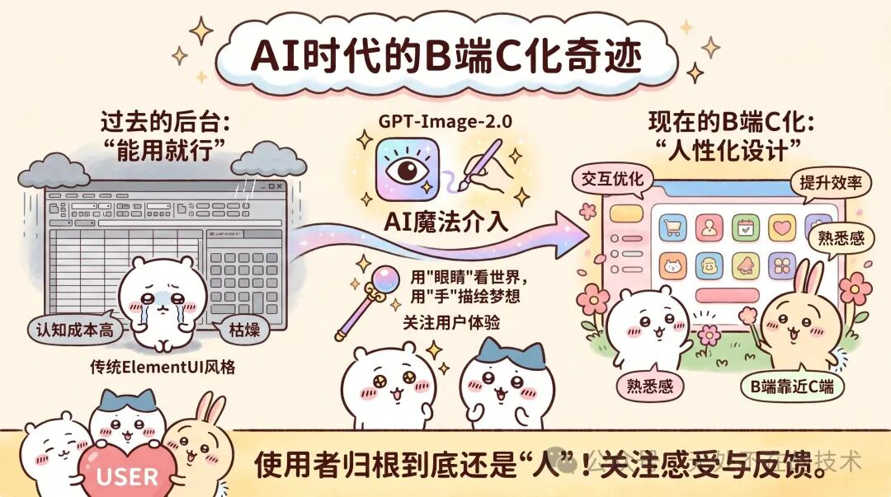

何为认知成本？

大家如果使用过一些C端系统，大家会发现很多时候我们马上就能学会上手使用，但是一到B端功能，就得需要别人讲解或者阅读下用户手册才行。这可以算做事一种认知成本。

比如看下网上的这个UI分享，能够帮助我们了解很多事：

https://www.zcool.com.cn/work/ZNjgzOTgwNjQ=.html

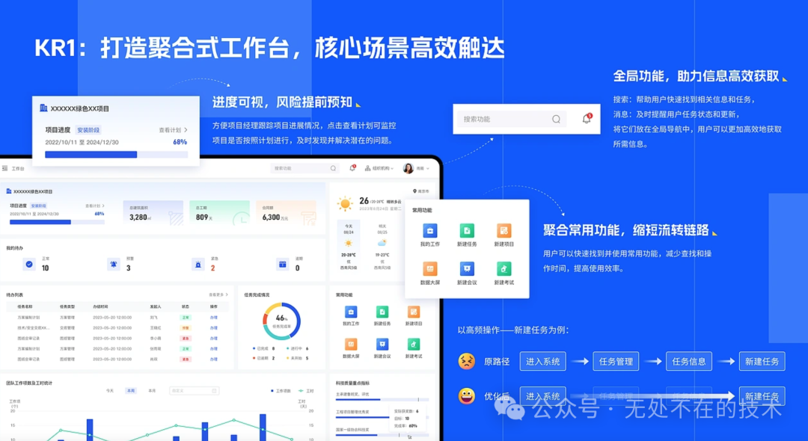

2026年，很多公司都开始要求程序员发生转变，前端需要会后端，后端需要用前端开发，从而实现提效和资源充分利用，那么在这个过程中，第一步我觉得就是如何通过AI做出一套好看的UI界面并落地到系统中。

这里我的经验是，我们可以使用如下内容进行处理：

1、使用Google的NanoBananaPro生成一些图标、图片、背景图

2、使用OpenAI的GPT-Image-2生成高保真的UI原型图、UI标注图、背景图

3、使用Google Stitch生成可交互的原型、使用ClaudeCode生成可交互的原型。

今天分享这个一些经验，本文也会持续更新。

**02**

**正文**

到了2026年，AI生态和周边技术悄悄地改变了产品设计和前端开发的关系——它们正在打通那条最耗时间的沟通“堵点”。

以前做一个产品页面，总像在玩接力赛：产品经理递过需求，设计师画好稿，前端再去还原。中间的每一次对齐颜色、间距、圆角、层级，甚至交互细节，都像在不断重复“对不对，对不对”的问答。最费时间的，不是不会做，而是反复确认，每一步都像在跟自己打赌：是不是最完美的版本。

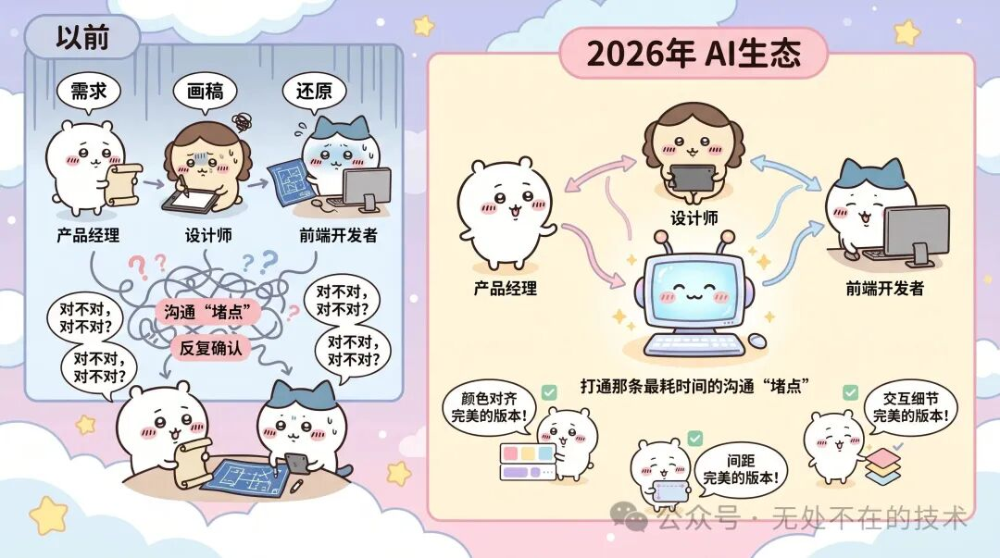

而现在，一条更顺畅的路出现了。你可以这样做：

1、让 AI 工具先生成一个基础功能的产品网页，或者找一个开源项目作为起点，就像搭好了舞台；

2、截图交给 GPT-Image-2.0，它就像一个懂你心思的画家，把界面变得更漂亮、更有灵魂；

3、从这张图里，反推出完整的 UI 规范，让设计的规则不再靠记忆和重复确认；

4、把截图和规范一起交回 AI，它就能按规范生成代码

5、然后，你只需坐下来，欣赏，调整，持续优化。

看似简单的五步，背后却是一场悄悄发生的革命：设计、规范、代码，不再是分散的工序，而被 AI 串成了一条闭环流水线。它像一位懂你节奏的伙伴，让创意流动自如，让每一次敲击都不再是重复，而是靠近理想的共舞。

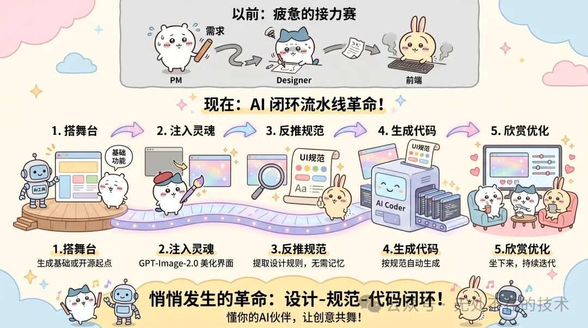

接下来，开始实操分享。

首先还是先了解下目前针对Vue市场的一些后端组件库，相关资料来源于网上：

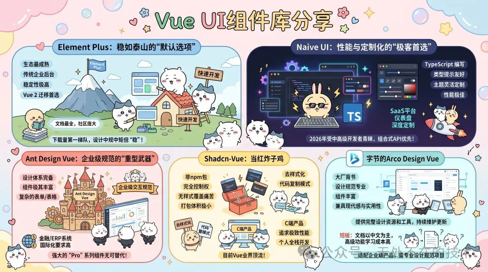

#### 1. Element Plus：稳如泰山的“默认选项”

如果你需要 **快速开发后台管理系统** ，或者团队对 Vue 2 的 Element UI 有感情，Element Plus 依然是首选。

- **特点**
	生态最成熟，文档最全，社区最庞大。你遇到的任何坑，网上都能找到答案。
- **适用场景**
	传统企业后台、对稳定性要求极高的项目、从 Vue 2 迁移的老项目。
- **现状**
	虽然设计风格略显中规中矩，但胜在“稳”。它是目前下载量稳居第一梯队的“老牌劲旅”。

#### 2. Naive UI：性能与定制化的“极客首选”

如果你追求 **极致的性能** 、 **TypeScript 支持** 以及 **丝滑的暗黑模式** ，Naive UI 是目前的最佳选择。

- **特点**
	完全使用 TypeScript 编写，类型提示非常友好。它的主题系统非常灵活，可以通过配置对象轻松定制样式。性能优化极佳，渲染速度快。
- **适用场景**
	SaaS 平台、对设计感和性能有要求的仪表盘、需要深度定制主题的项目。
- **现状**
	在 2026 年，它凭借优秀的架构（组合式 API 优先）和灵活的定制能力，赢得了大量中高级开发者的青睐。

#### 3. Ant Design Vue：企业级规范的“重型武器”

如果你的项目是 **超大型企业级应用** ，且团队习惯蚂蚁金服的设计规范，选它没错。

- **特点**
	设计体系最完备，组件极其丰富（尤其是复杂的表单和表格）。它不仅仅是 UI 库，更是一套完整的企业级交互规范。
- **适用场景**
	复杂的金融/ERP 系统、对国际化有极高要求的项目。
- **现状**
	虽然社区对其维护节奏偶有争议，但其强大的“Pro”系列组件（如 ProTable）在解决复杂业务场景时依然无可替代。

4、Shadcn-Vue：当红炸子鸡

如果你不想被组件库的默认样式束缚，或者想构建 **独一无二** 的 C 端产品，据说Shadcn-Vue 是目前的Vue业界顶流。今年最火的趋势是 **“去样式化”** 和 **“代码复制”** 模式。

- **模式**
	它不是一个 npm 包，而是让你 **复制粘贴代码** 到项目中。基于 **Tailwind CSS** 和 **Reka UI** （无头组件库）。
- **优势**
	你拥有代码的完全控制权，没有“样式覆盖”的痛苦，打包体积极小。
- **适用场景**
	对 UI 设计有独特要求的产品、追求极致性能的项目、个人全栈开发。

5、字节的Arco Design Vue

大厂背书的Arco Design Vue表现亮眼，作为字节跳动开源的企业级设计系统，支持Vue和React双版本。核心总结：设计规范专业、组件丰富，兼具现代感与实用性，提供完整设计资源和配套工具，持续维护更新；短板是文档以中文为主，高级功能学习成本稍高，适配企业级产品、需专业设计规范的项目。

针对本文的场景，我选择的还是自己熟悉的ElementUI体系的，首先我们让AI做个关于Vue3+ElementUI Plus的后台管理系统项目，这个项目是智慧养老后台管理系统，通过该平台可全面管理用户健康信息及健康数据，提高运营及服务效率。计划目前只有一个演示功能用户管理和首页。

这里也可以自己找个已经存在的开源项目，本文我使用了ClaudeCode、MiniMax2.7、Opus4.6、Trae、Kimi2.6的不同组合，每个地方都有擅长的内容。

首先，我们进入到ClaudeCode的控制台：

```bash
claude  --dangerously-skip-permissions
```

然后输入我们的提示词：

```text
做个关于Vue3+ElementUI Plus的后台管理系统项目，这个项目是智慧养老后台管理系统，通过该平台可全面管理用户健康信息及健康数据，提高运营及服务效率。目前只有一个演示功能用户管理和首页和登录也，帮我创建个项目吧。
```

截图：

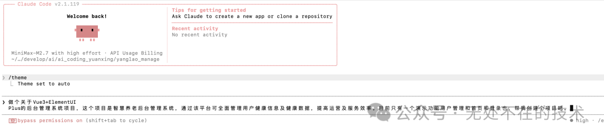

等待一会儿后，我们的原型项目基础架子就完成了：

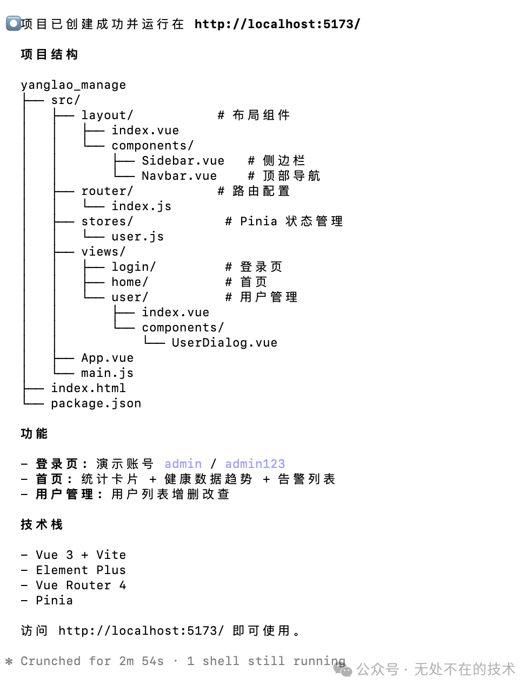

然后我们先访问下浏览器看下效果：登录界面：

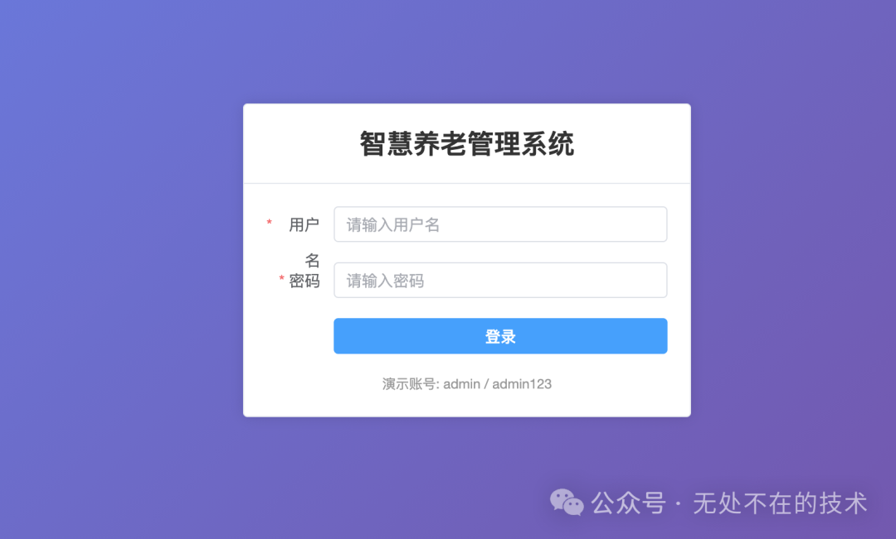

再看下后台界面：

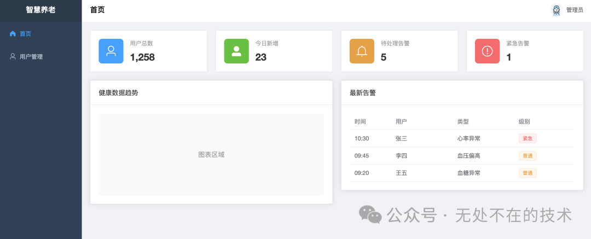

在看下用户管理的界面，也是非常简单的，基本的交互都有了：

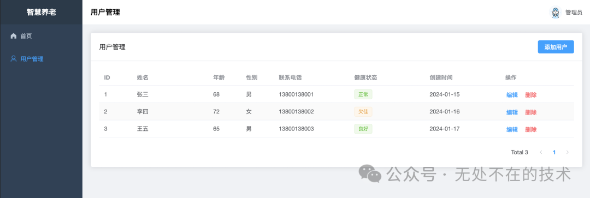

目前很多系统的后台也就是这样吧，能用就行，不在乎用户体验，截图交给 GPT-Image-2.0，把界面变得更漂亮、更有灵魂；这里我用的是API易网站代理服务实现的AI生图，可以访问：

https://imagen.apiyi.com/#generate

输入我们的提示词：

```text
请基于我当前提供的参考图片，给我做个符合C端的漂亮的交互界面UI设计，现代化设计，颜色主题色系为绿色，当前系统计划为一个智慧养老系统。同时生成的UI图中给我标注清楚配色规范、字体规范等，标注需要非常完整，每个地方都进行标注
```

截图：

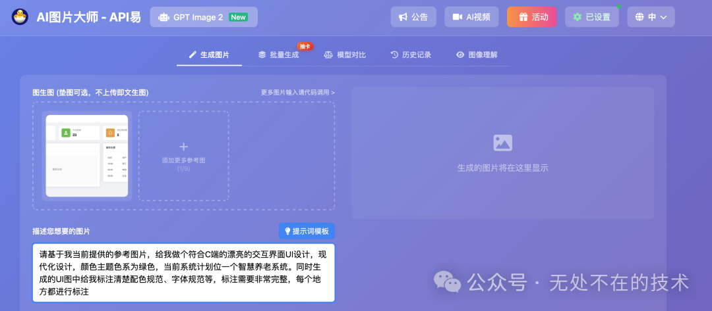

等待一会儿后，我们可以看到生成的结果了：

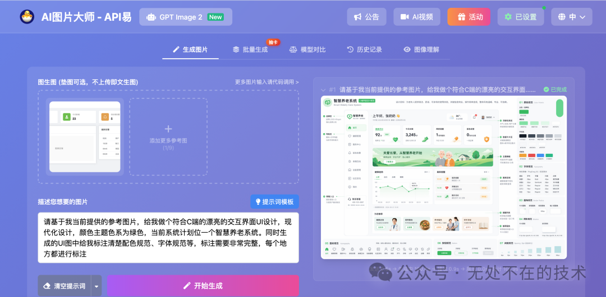

下载后，我们可以得到一份非常给力的UI设计稿图片，由于我第一次选择的是1K的图片，因此可能有些看不清楚：

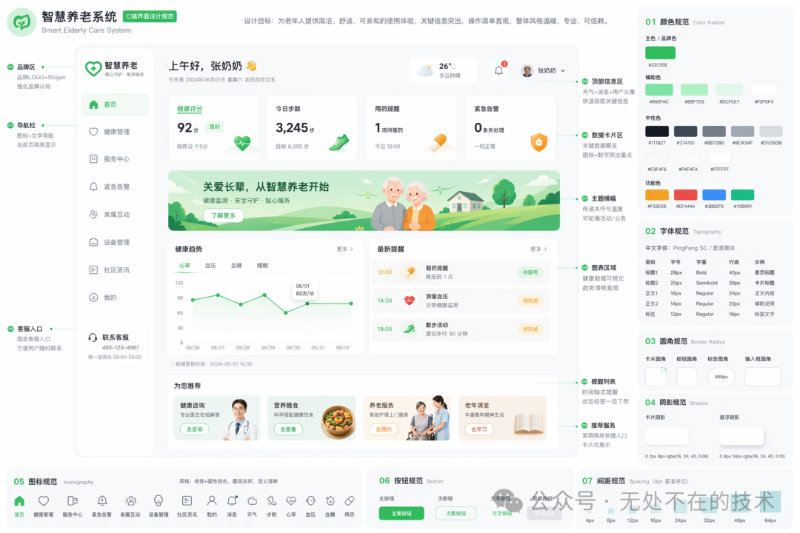

于是我又进行了第2次的高清的，4K分辨率的生成，效果如下：

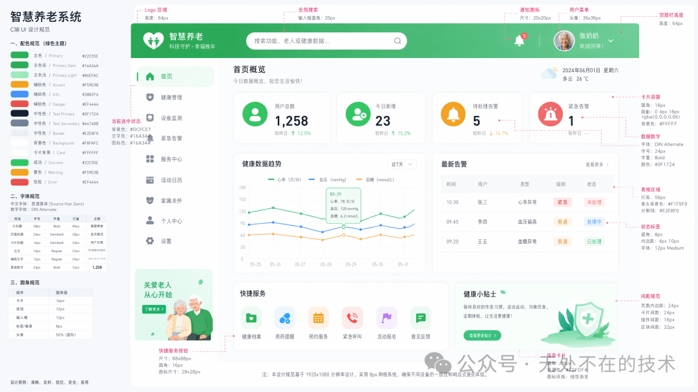

可以看到这个高清的图片效果是非常不错的，完全超出了我们的认知。同时很多交互符合一些C端后台UI界面的设计。

接下来，我们可以继续让AI大模型去分析和识别当前图片中的规范，形成文档：

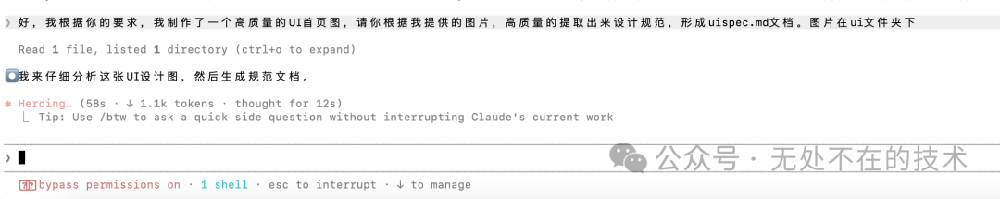

等待一会儿后，我们可以看到产出了一个文档，目前看了一下我使用的存在非常大的幻觉，图片中的很多小字没有提取出来。某些简单场景目前看是OK的。这里为了产出规范不一定需要用AI来识别，也可以通过一些原型设计工具把规范提取出来。

我换了几个模型不太行，于是我使用了Google Stictch。

提示词如下：

```text
请基于我提供的图片做个完全一致的UI界面，保持相同的配色规范、字体规范、间距规范等等
```

于是我们在谷歌的界面等待后，看到了一下效果，基本的信息颜色提取出来了，做的一版原型还是有待优化：

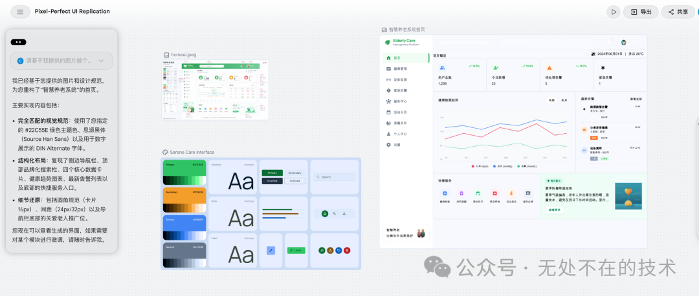

虽然效果没有完全还原，但是通过下载，我们可以获取到DESIGN.md文档，这个文档中已经包含了相关的规范和样式。

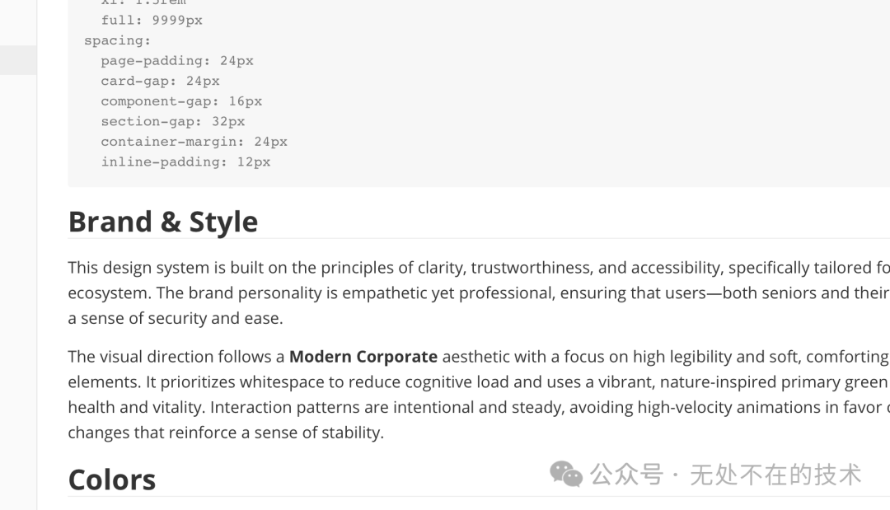

其实，我们可以让GPT-Image-2这个模型，基于我们当前的原型，重新生成一张只包含标注结果的规范的图，不包含原型的，这样效果比较好。而不是把原型图片和标注放在一起。

例如：

我们使用GPT-Image-2模型，输入提示词让他把规范整理下：

```text
请基于我当前提供的参考图片，将这个系统的设计规范单独制作一张图片，不包含原型，只清晰说明规范，配色规范、字体规范等
```

效果如下：

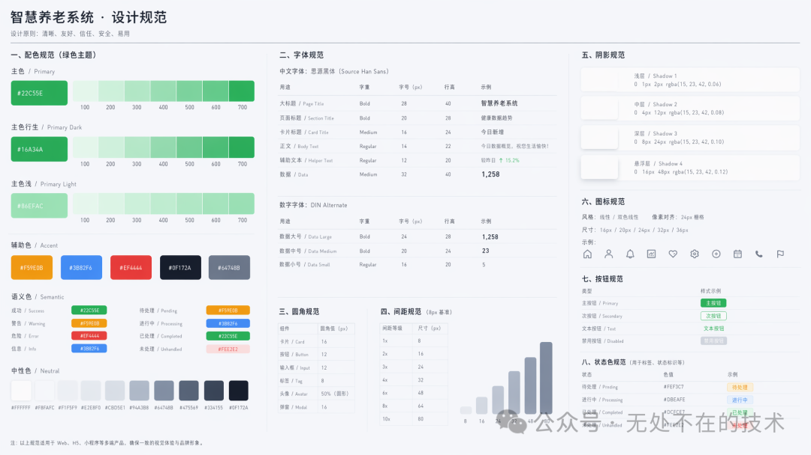

有了这个图后，我们可以让不同的模型从多个角度提取出来准确的规范说明.

这里我也使用了我之前用过的NanoBananaPro来实现UI规范的生成，也是同一套提示词，效果目前看确实没有最新的pgt-image-2.0好，不过也还行：

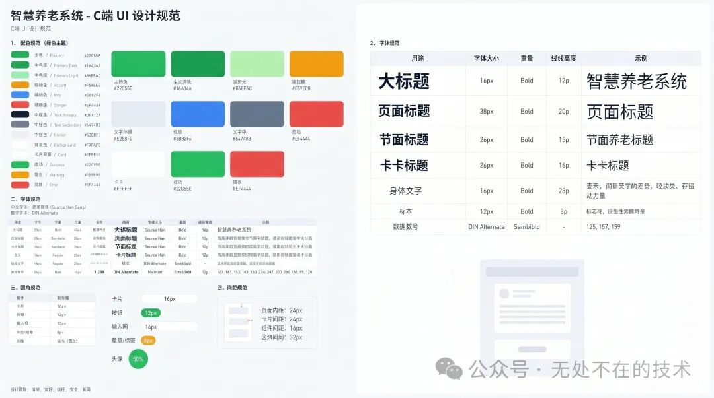

基于这个最新的纯规范设计的文档，比如我用Trae里面的Kimi2.6，是非常完整的提取出来了：

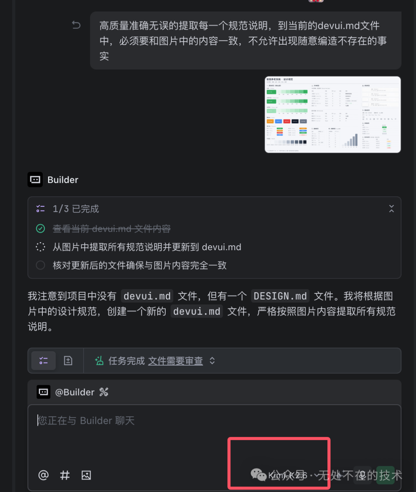

结果也基本上是对的，因此，我们如果要做图片内容提取，得找个图片理解支持较好的模型：

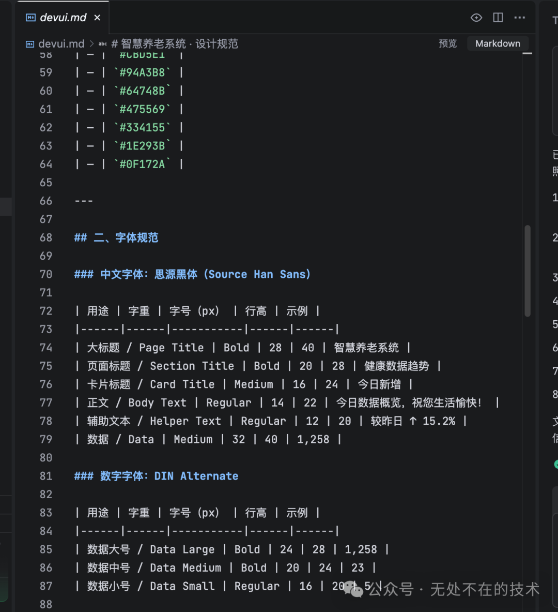

我也用ClaudeCode+Opus模型进行了提取，目前看效果并不好，估计是模型不擅长图片理解。

到这里其实我们已经具备基本的要素：UI原型设计稿+规范说明。接下来我们把把截图和规范一起交回 AI，它就能按规范生成代码。

接下来我们就有了谷歌的Design.md、Trae里面输出的规范、UI原型稿，接下来我们可以让AI开始开发。

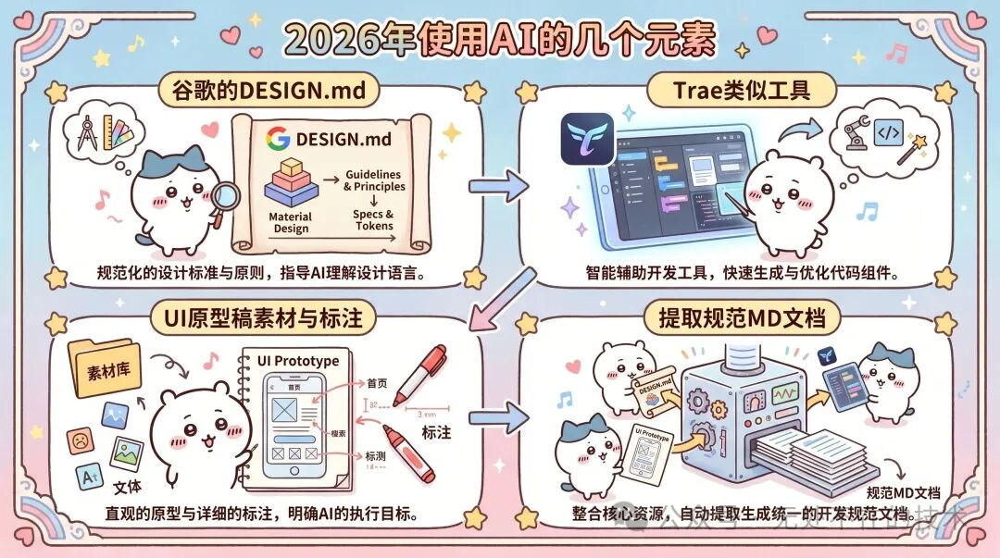

这里我先选择Trae进行了尝试，使用Trae里面的Kimi2.6进行整理。

提示词：

```text
请基于ui文件夹下的design.md设计规范、devui.md的文字性规范说明、homeui这个设计稿原型，将当前项目的后台首页界面给我完整还原出来和开发，确保质量高保真UI效果图
```

截图：

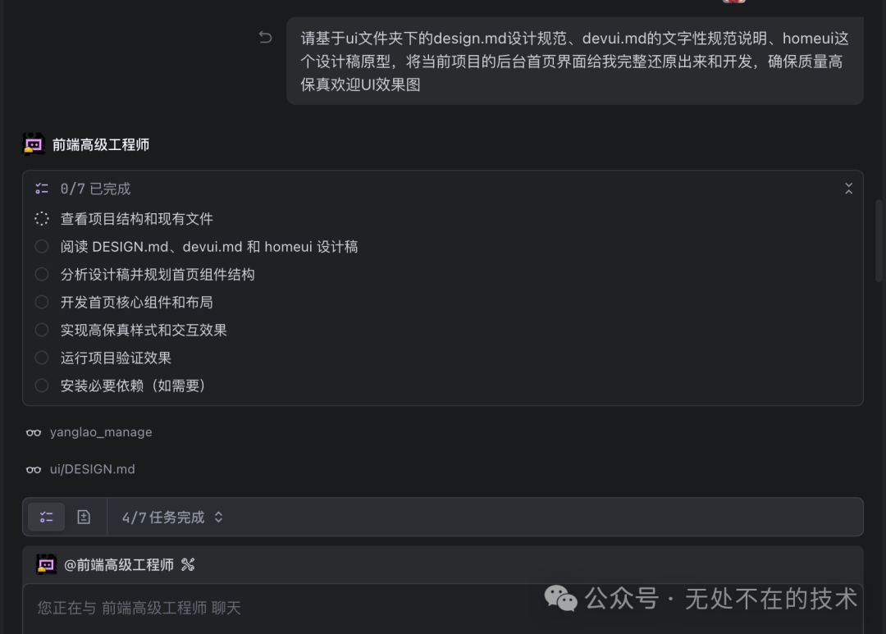

接下来我们等待一下即可，目前看在Trae里面执行也是OK的。

接下来看看我们用Trae开发出来的效果，可以看到目前KIMI-2.6模型执行的效果也是非常不错的。

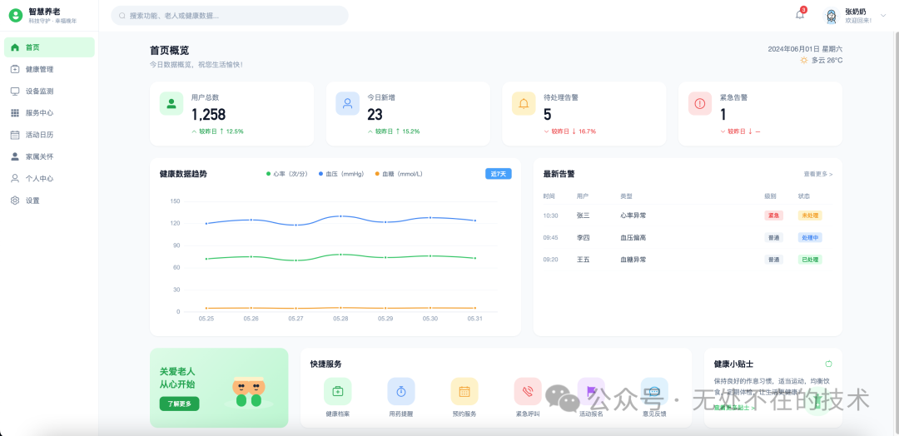

接下来我又让AI继续搞了一次：

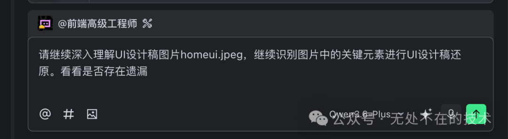

AI已经识别出来哪些存在遗漏的情况了:

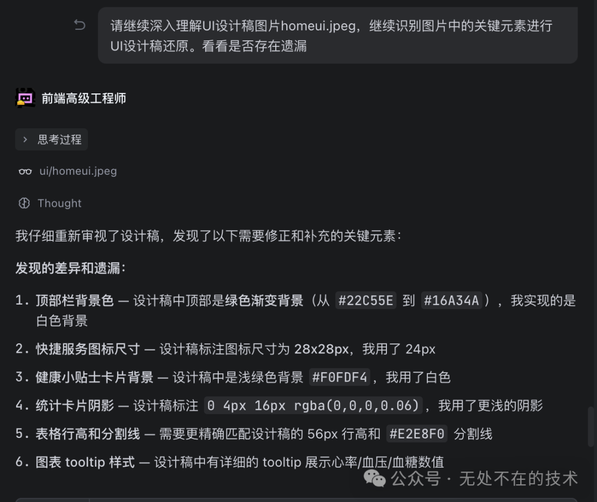

接下来我们继续等待效果，效果也是OK的。

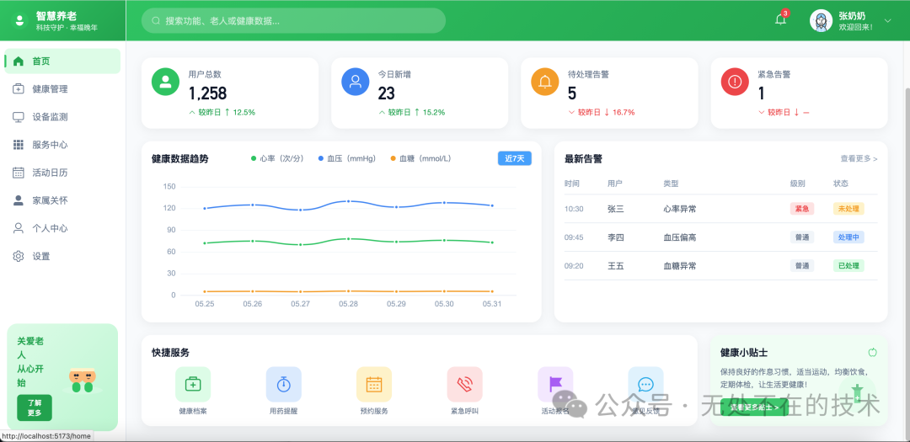

有时候，我们发现某个地方自己没灵感，不知道如何更改，也可以让GPT-Image-2模型来帮助我们设计，我们提示词为：

```text
请基于我当前提供的参考图片，我做的系统，我想设计8组不同风格和交互系统NavBar效果，给我设计一下吧，交互体验要好，符合C端场景
```

再来看看生成的效果吧，如下所示：

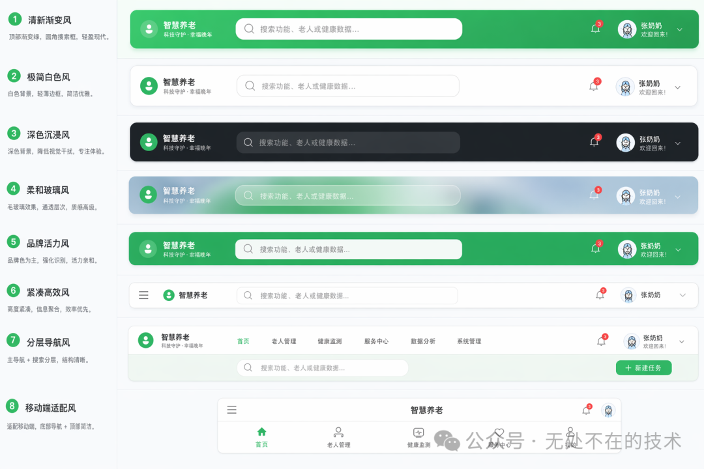

效果也是非常OK的，我们可以让AI基于自己喜欢的风格进行改造。

这个生图的模型的潜力还是有很多。

对于一些原型设计的灵感，可以参考我经常阅读的网站：https://www.axureshop.com/

**03**

**总结**

经过这次实践，我们看到了一条完整的路径：

**想法 → 草网页 → 效果图 → 设计规范 → 可落地代码**

在过去，每一层之间都像隔着厚厚的沟壑，需要人力去搬运、去对齐、去校验。而在AI的助力下，这些隔阂被悄悄打通。

一张草网页，不再只是草网页，它可以变成视觉输入；

一张AI美化后的UI图，也不只是效果图，它可以继续生长，生成完整的设计规范；

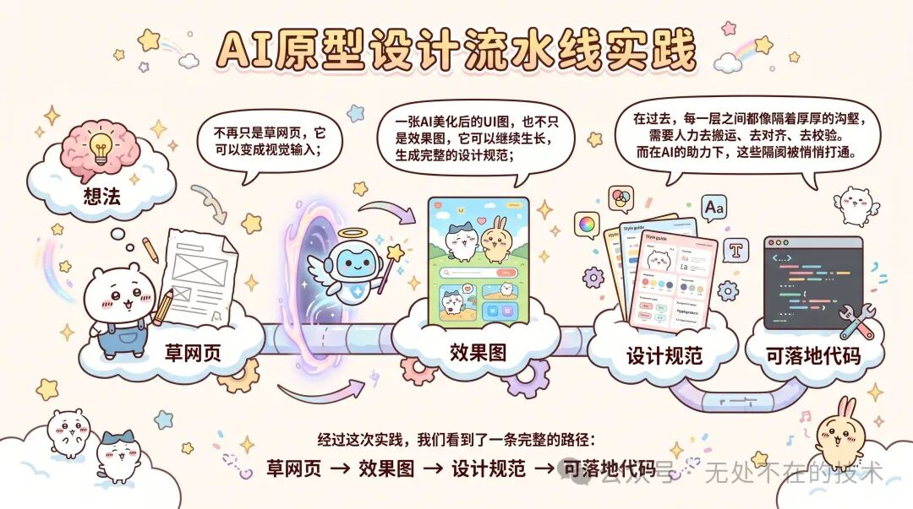

设计规范回到AI手中，又能生成高保真的可落地代码。

在这条闭环流水线上，AI不再是冷冰冰的工具，而是像一位懂你节奏的伙伴，陪伴你的创意从萌芽到实现。它让创意流动自如，让每一次敲击都不再是重复，而是靠近理想的共舞。

最终，我们看到了一个微小但真实的奇迹： **设计、规范、代码，被串联成了一条可以反复迭代、持续优化的闭环流水线** 。

未来，当AI与人类的协作越发成熟，我们不只是提高效率，更在重新定义“可能”：每一次灵感，都能被迅速可视化、落地化，变成触手可及的现实。

本专题系列文章：

[VibeCoding实践第1节：字节Trae实现简历与简历生成器](https://mp.weixin.qq.com/s?__biz=MzIzNDAwODMxNA==&mid=2648933398&idx=1&sn=f0767501d3deead1244dd45dea216951&scene=21#wechat_redirect)

[AI编程实践第2节：Spec规范驱动开发(SDD)1024游戏](https://mp.weixin.qq.com/s?__biz=MzIzNDAwODMxNA==&mid=2648933454&idx=1&sn=8946cc4208f086a566ebe17ec5d43c24&scene=21#wechat_redirect)

[AI编程实践第3节：Trae实现Web管理后台界面，效果出奇好](https://mp.weixin.qq.com/s?__biz=MzIzNDAwODMxNA==&mid=2648933488&idx=1&sn=7363df213042cd96aa028e6a428e08e6&scene=21#wechat_redirect)

[AI编程实践第4节：基于GPT5+Trae实现MCP服务市场](https://mp.weixin.qq.com/s?__biz=MzIzNDAwODMxNA==&mid=2648933706&idx=1&sn=d11ee4f71a32ae4b8ae9d33585e49a34&scene=21#wechat_redirect)

[AI编程实践第5节：Trae梳理解构项目业务与代码流程](https://mp.weixin.qq.com/s?__biz=MzIzNDAwODMxNA==&mid=2648934562&idx=1&sn=3e83156ca8f79c46c95eee0332bca11a&scene=21#wechat_redirect)

[AI编程实践第6节：秒哒开发微信表情包生成应用](https://mp.weixin.qq.com/s?__biz=MzIzNDAwODMxNA==&mid=2648934590&idx=1&sn=8716eec7ae19b93200910df8137905f8&scene=21#wechat_redirect)

[AI编程实践第7节：Git WorkTree机制实现分支并行开发](https://mp.weixin.qq.com/s?__biz=MzIzNDAwODMxNA==&mid=2648934884&idx=1&sn=9992d88d82167216fbe1a7351065c5ad&scene=21#wechat_redirect)

[AI编程实践第8节：使用Understand Anything理解项目关系图谱](https://mp.weixin.qq.com/s?__biz=MzIzNDAwODMxNA==&mid=2648934907&idx=1&sn=32d2b3e3442e06ed63e5e73c5c85f64c&scene=21#wechat_redirect)

[AI编程实践第9节：阿里秒悟与谷歌Stitch平台实现需求界面原型设计](https://mp.weixin.qq.com/s?__biz=MzIzNDAwODMxNA==&mid=2648934940&idx=1&sn=696a70edddea7ee3bbe373e49b4ddca2&scene=21#wechat_redirect)

最近也看到有人问如何学习AI，这里分享几个资料如下：

1、通往AGI之路的知识库飞书云文档

https://waytoagi.feishu.cn/wiki/QPe5w5g7UisbEkkow8XcDmOpn8e

2、掘金的AI知识库的飞书云文档

https://agijuejin.feishu.cn/wiki/UvJPwhfkiitMzhkhEfycUnS9nAm?table=blk3RfZtR7Nh73tO

3、极客时间的AI知识库的飞书云文档

https://geek-agi.feishu.cn/wiki/B9rYwwg6xidZYJkbrlscxTQFnOc

4、LangGPT社区的飞书云文档（结构化提示词等等）

https://langgptai.feishu.cn/wiki/RXdbwRyASiShtDky381ciwFEnpe

5、一站式AI产品经理飞书知识库

https://v11enp9ok1h.feishu.cn/wiki/KiIvwdFOciiqqNkwKzTcmn88ndL

6、微软网站分享的AI指南说明知识

https://learn.microsoft.com/zh-cn/azure/databricks/generative-ai/guide/introduction-generative-ai-apps

7、赋范空间的飞书AI知识库：

https://kq4b3vgg5b.feishu.cn/wiki/ETqzwH4THiTY8kkGqAucYbSonPt

\- END -

作者提示: 个人观点，仅供参考
