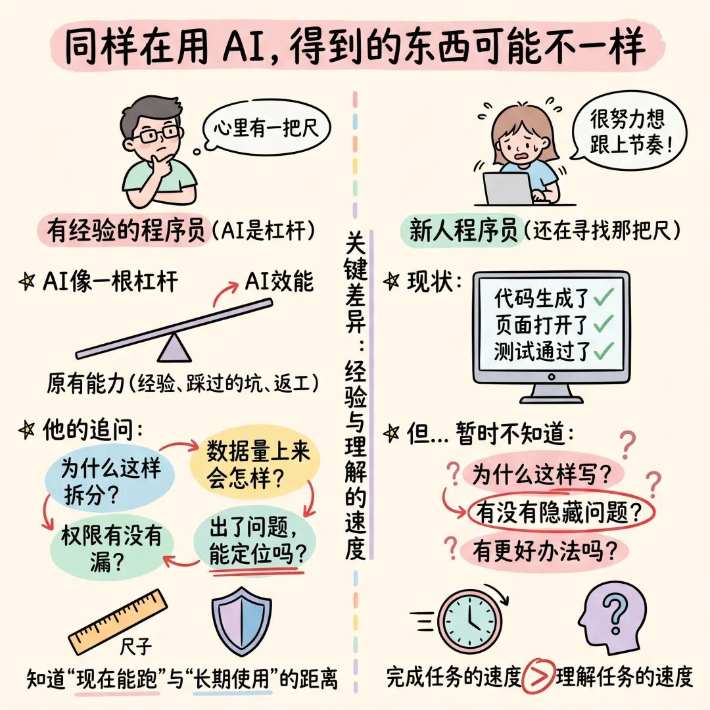
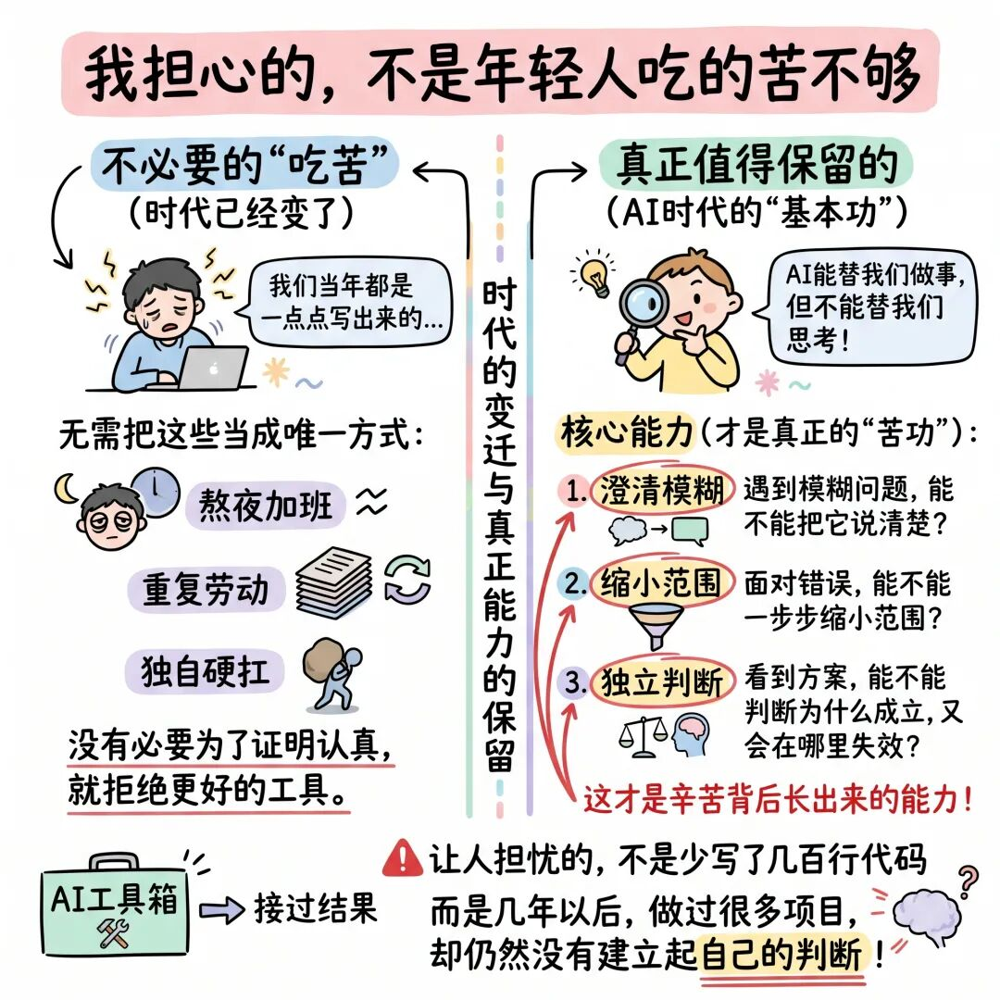
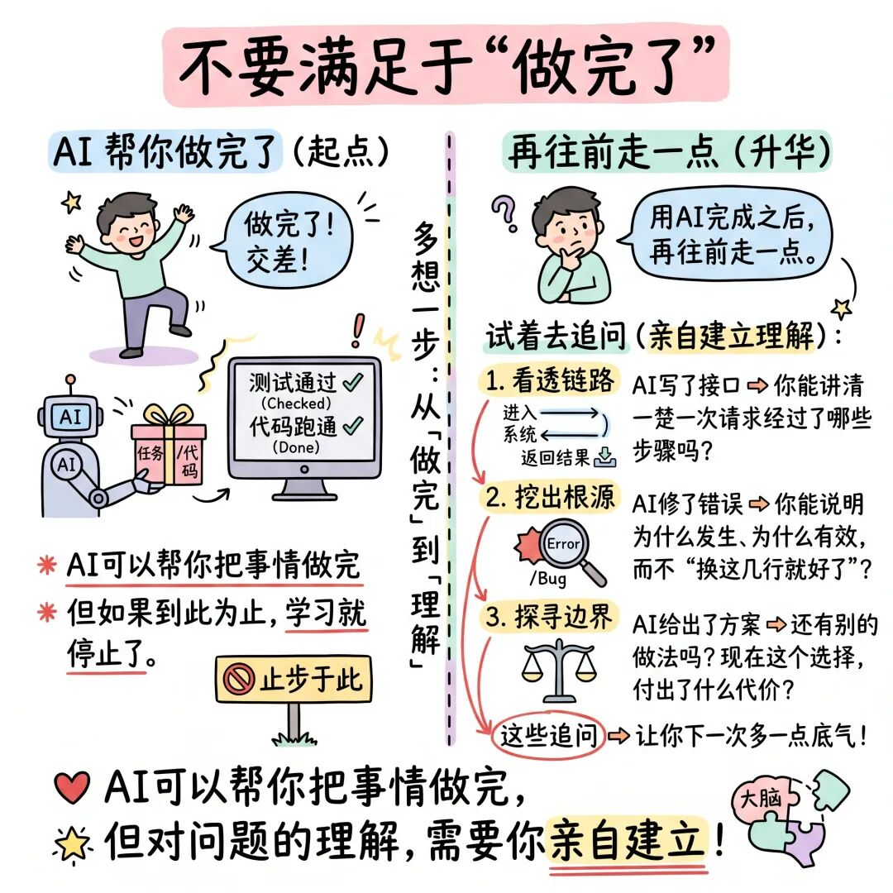
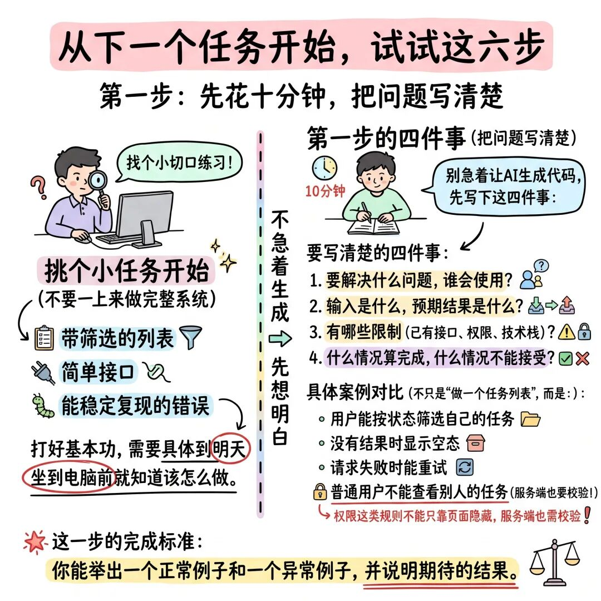
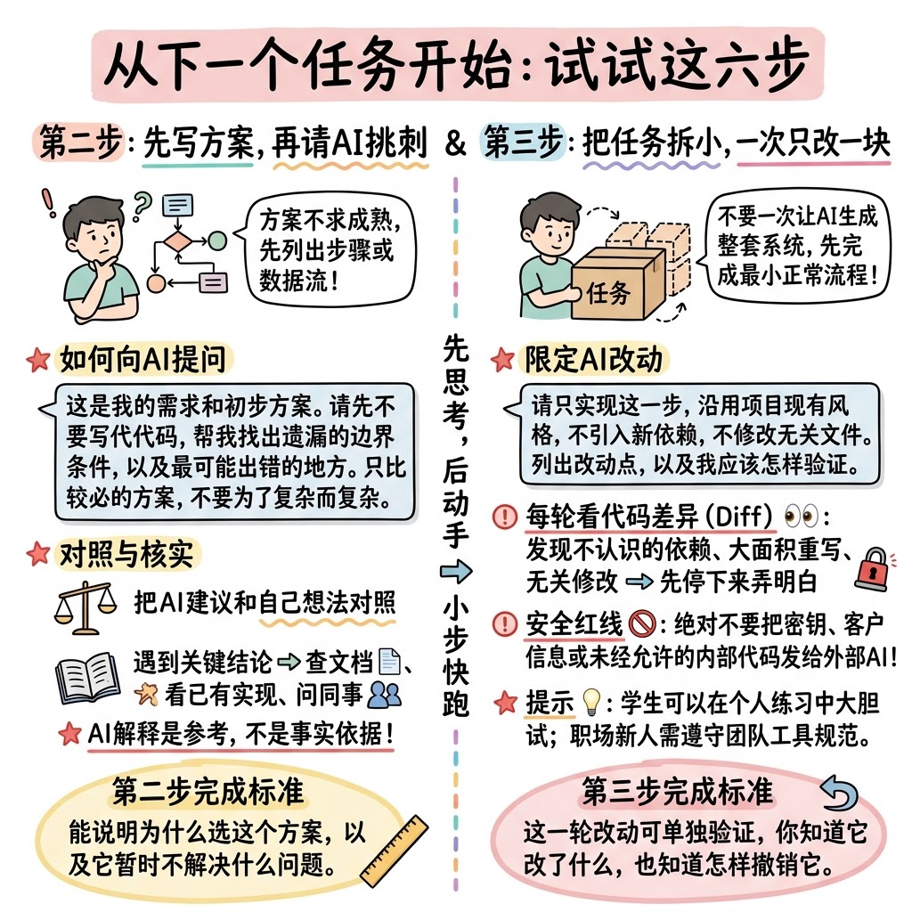
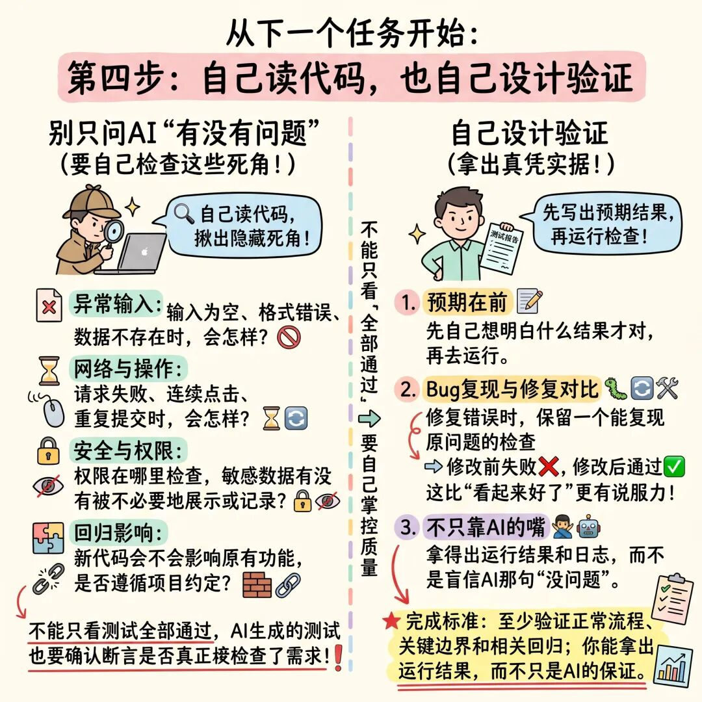
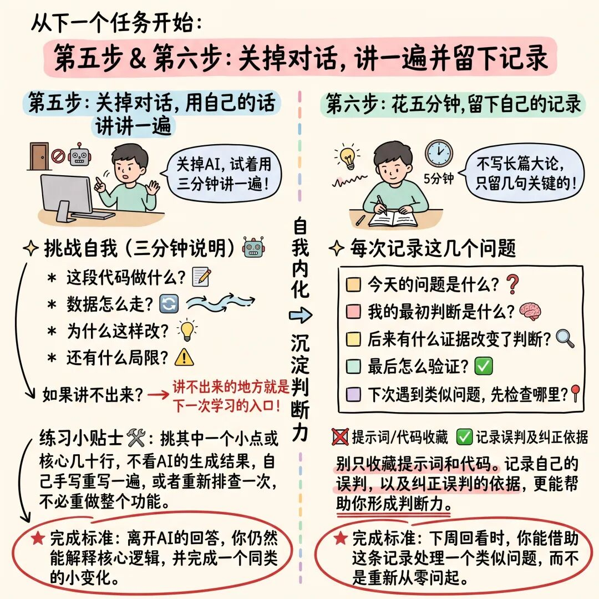
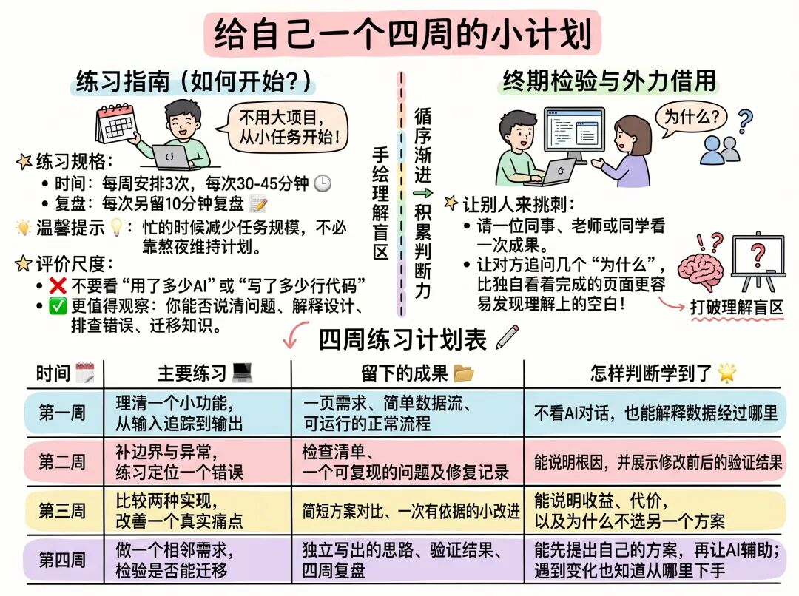
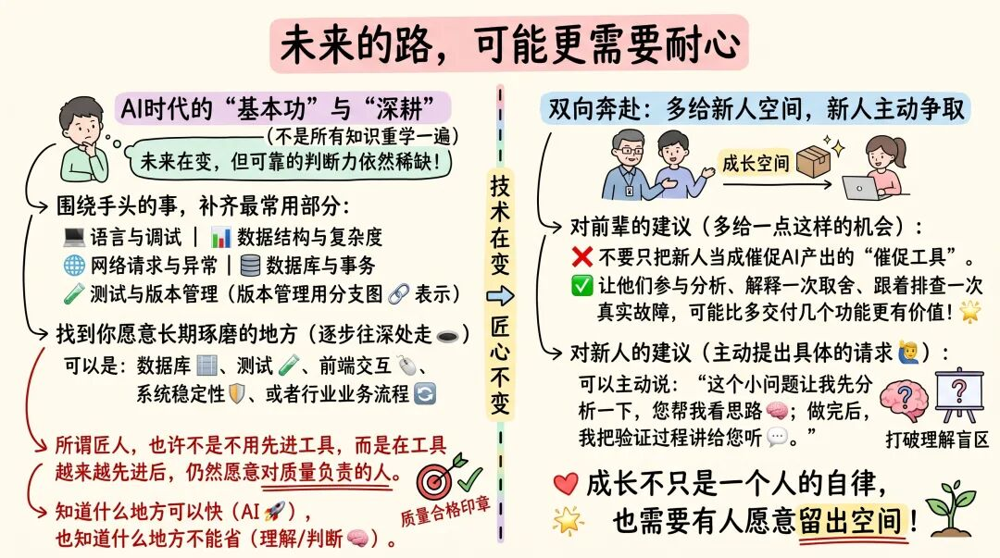
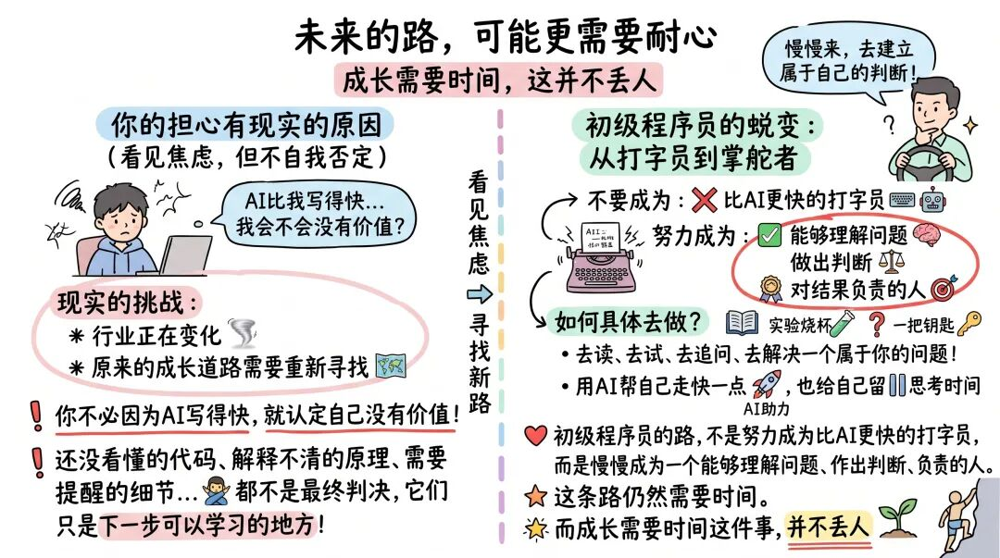

> 转载自微信公众号「无处不在的技术」，2026-10-24，核心观点与素材版权归原作者所有。
> url: https://mp.weixin.qq.com/s/kOHAEei-dYaa4mXO1XA9OQ

最近，我越来越强烈地感受到：AI正在改变软件研发，也在改变一个普通人进入这个行业的方式。身边越来越多的人开始用AI写代码。过去要查半天资料、调一下午的功能，现在描述清楚需求，几轮对话之后，就能看到一个像模像样的结果。

对工作多年的人来说，这是一种很实在的解放。那些重复的、琐碎的、早已知道怎么做却仍要亲手做一遍的事情，终于有人可以分担了。一个有积累的人，也因此有机会承担过去需要多人配合才能完成的工作。

但看着这些变化，我也会想起另外一群人。

他们还在学校，或者刚刚毕业。刚装好开发环境，刚学会写接口，刚准备走进这个行业，就发现很多原本属于 **“新手练习”的工作，AI已经能做了** 。前辈正在用AI放大积累，新人却可能在还没有积累的时候，就跳过了积累的过程。

这是我真正担心的事，也是最近很多专家提到的现象。本文分享下自己最近的一些思考。分享之前，分享一下今年总结整理过的一些成长经验的文章：

[为什么技术人一开口，业务就听不懂了？](https://mp.weixin.qq.com/s?__biz=MzIzNDAwODMxNA==&mid=2648935985&idx=1&sn=1430654e04af24d29bd822546f2bdd66&scene=21#wechat_redirect)

[AI Coding时代SDD编程的三层境界，你现在处在哪一层](https://mp.weixin.qq.com/s?__biz=MzIzNDAwODMxNA==&mid=2648935950&idx=1&sn=fac46ee3a7e0e458605c3d60322ae873&scene=21#wechat_redirect)

[AI Coding时代，为什么有些程序员慢慢掉队了？](https://mp.weixin.qq.com/s?__biz=MzIzNDAwODMxNA==&mid=2648935814&idx=1&sn=beb4e73a807e98dfa768b14938824b57&scene=21#wechat_redirect)

[AI Coding时代程序员的个人价值已被重新定义](https://mp.weixin.qq.com/s?__biz=MzIzNDAwODMxNA==&mid=2648935659&idx=1&sn=c2f4030c2025b96616b459bf2f747a56&scene=21#wechat_redirect)

[精华：AI Coding 时代，把最好的工程师从「写功能」挪到「搭流水线」](https://mp.weixin.qq.com/s?__biz=MzIzNDAwODMxNA==&mid=2648935519&idx=1&sn=0bebf54ab87160848988dcf67a1fe1af&scene=21#wechat_redirect)

[与AI一起成长：AI时代我的6个方法经验分享给你](https://mp.weixin.qq.com/s?__biz=MzIzNDAwODMxNA==&mid=2648934873&idx=1&sn=d358180a7f063a6cc0f1b7a7e1a5ceab&scene=21#wechat_redirect)

一、同样在用AI，得到的东西可能不一样？

一位有经验的程序员让AI生成代码，心里往往有一把尺。他知道需求哪里不完整，知道这个设计以后可能难以维护，也知道“现在能跑”和“可以长期使用”之间，还有很长一段距离。

AI给出一个方案，他会追问： **为什么这样拆分？数据量上来会怎样？权限有没有漏？出了问题，能不能定位** ？这些判断，不是AI出现之后才有的。它们来自过去解决过的问题，踩过的坑，以及那些并不轻松的返工。



所以，AI像一根杠杆，把他原有的能力放大了。但新人手里，可能还没有那把尺。

代码生成了，页面打开了，测试也通过了。至于为什么这样写，有没有隐藏的问题，还有没有更好的办法，暂时不知道。

这不是新人不努力。有时恰恰是因为他们很努力地想把任务完成，想证明自己能做好，想赶紧跟上团队的节奏。

只是，完成任务的速度变快了，理解任务的速度，却未必一起变快。

## 二、我担心的，不是年轻人吃的苦不够

谈到基本功，很容易变成一句熟悉的话：“ **我们当年都是自己一点点写出来的** 。”

但时代已经变了。没有必要为了证明认真，就拒绝更好的工具。也不必把熬夜、重复劳动、独自硬扛，当成成长的唯一方式。真正值得保留的，不是过去那些辛苦的形式，而是辛苦背后长出来的能力：

> 遇到一个模糊的问题，能不能把它说清楚？
> 
> 面对一个错误，能不能一步步缩小范围？
> 
> 看到一个方案，能不能判断它为什么成立，又会在哪里失效？

这些能力，以前常常在查资料、写代码、调试的过程中慢慢形成。



如今，AI可以替我们完成其中很多步骤。如果我们只是接过结果，这段学习就可能悄悄消失。最让人担忧的，不是少写了几百行代码，而是几年以后，我们做过很多项目，却仍然没有建立起自己的判断。

## 三、不要满足于“做完了”

我很认同一位前辈的提醒： **用AI完成之后，再往前走一点。不一定每天研究多么高深的架构。可以从一个很小的问题开始** 。

今天AI帮你写了一个接口，你能不能讲清楚，一次请求从进入系统到返回结果，经过了哪些步骤？它帮你修好了一个错误，你能不能说明，错误为什么发生，修改为什么有效，而不是只记住“换成这几行就好了”？

它给出一种设计，你能不能再问一句：还有别的做法吗？现在这个选择，付出了什么代价？

这些追问，未必立刻让你交付得更快。但它们会让下一次的你，比这一次多一点底气。



**AI可以帮你把事情做完，但对问题的理解，需要你亲自建立** 。

## 四、从下一个任务开始，试试这六步

“打好基本功”是对的，但对一个刚入行的人来说，这句话还不够具体。我们需要的，是明天坐到电脑前，就知道可以怎样做。

下面这套方法，不是保证成长的标准答案。它是一种可以尝试、可以根据工作节奏调整的练习方式。先挑一个小任务，例如带筛选的列表、简单接口，或者一个能够稳定复现的错误，不必一上来做完整系统。

**第一步：先花十分钟，把问题写清楚**

先别急着让AI生成代码。用自己的话写下四件事：

> 要解决什么问题，谁会使用？
> 
> 输入是什么，预期结果是什么？
> 
> 有哪些限制，例如已有接口、权限、技术栈？
> 
> 什么情况算完成，什么情况不能接受？

例如，不只写“做一个任务列表”，而是写：

```plain
“用户能按状态筛选自己的任务；没有结果时显示空态；请求失败时能重试；普通用户不能查看别人的任务。”
```

这一小步的完成标准：你能举出一个正常例子和一个异常例子，并说明期待的结果。



权限这类规则不能只靠页面隐藏实现，服务端也需要校验。把这样的约束说清楚，本身就在训练工程判断。

**第二步：先写自己的方案，再请AI帮你挑问题**

不要求方案成熟。画一条简单的数据流，或者列出三五个实现步骤，就够了。

然后可以这样问AI：

```plain
这是我的需求和初步方案。请先不要写代码，帮我找出遗漏的边界条件，以及最可能出错的地方。只比较必要的方案，不要为了复杂而复杂。
```

把AI的建议和自己的想法对照。遇到关键结论，再查项目已有实现、官方文档，或请教同事。AI的解释可以帮助理解，但不能自动成为事实依据。

完成标准：你能说明为什么选这个方案，以及它暂时不解决什么问题。



**第三步：把任务拆小，一次只让AI改一块**

先完成最小的正常流程，验证后再补异常处理，不要一次让AI生成整套系统。

可以明确告诉它：

```plain
请只实现这一步，沿用项目现有风格，不引入新依赖，不修改无关文件。列出改动点，以及我应该怎样验证。
```

每轮都看一下代码差异。发现不认识的依赖、大面积重写、与任务无关的修改，先停下来弄明白。

学生可以在个人练习项目里大胆尝试；职场新人应遵守团队的工具使用规范。不要把密钥、客户信息或未经允许的内部代码发给外部AI服务。

完成标准：这一轮改动可以单独验证，你知道它改了什么，也知道怎样撤销自己的这轮改动。

**第四步：自己读代码，也自己设计验证**

不要只问AI“有没有问题”。检查下面这些地方：

> 输入为空、格式错误、数据不存在时，会怎样？
> 
> 请求失败、连续点击、重复提交时，会怎样？
> 
> 权限在哪里检查，敏感数据有没有被不必要地展示或记录？
> 
> 新代码会不会影响原有功能，是否遵循项目约定？

先自己写出预期结果，再运行对应检查。AI生成的测试，也要确认断言是否真正检查了需求，不能只看“全部通过”。

修复错误时，尽量保留一个能复现原问题的检查：修改前失败，修改后通过。这比“看起来好了”更有说服力。



完成标准：至少验证正常流程、关键边界和相关回归；你能拿出运行结果，而不只是AI的保证。

**第五步：关掉对话，用自己的话讲一遍**

试着用三分钟说明：这段代码做什么，数据怎么走，为什么这样改，还有什么局限。讲不出来的地方，就是下一次学习的入口，不是需要遮掩的缺点。挑其中一个小点，不看生成结果，重新写一遍或重新排查一次。只选核心的几十行也可以，不必把整个功能重做。

完成标准：离开AI的回答，你仍然能解释核心逻辑，并完成一个同类的小变化。



**第六步：花五分钟，留下自己的记录**

不用写长篇总结。每次留下几句话就好：

> 今天的问题是什么？我的最初判断是什么？后来有什么证据改变了判断？最后怎么验证？下次遇到类似问题，我会先检查哪里？

别只收藏提示词和代码。记录自己的误判，以及纠正误判的依据，更能帮助你形成判断力。

完成标准：下周回看时，你能借助这条记录处理一个类似问题，而不是重新从零问起。

## 五、给自己一个四周的小计划

如果你不知道从哪里开始，可以选一个“小任务管理”练习项目，连续做四周。工作中的同学，也可以用获准的小任务替代，不需要额外做一个大项目。



**不要把“用了多少AI”“写了多少行代码”当成成绩** 。

更值得观察的是：你能否先说清问题，能否解释设计，能否依据证据排错，能否把学过的东西用到新的场景。

有空的话，请一位同事、老师或同学看一次成果。让对方追问几个“为什么”，比独自看着完成的页面更容易发现理解上的空白。

也可以阅读： [与AI一起成长：AI时代我的6个方法经验分享给你](https://mp.weixin.qq.com/s?__biz=MzIzNDAwODMxNA==&mid=2648934873&idx=1&sn=d358180a7f063a6cc0f1b7a7e1a5ceab&scene=21#wechat_redirect)

## 六、未来的路，可能更需要耐心

未来五到十年，软件研发会变成什么样，没有人能够说准。

初级岗位会不会减少，企业会怎样培养新人，不同方向的机会在哪里，这些都值得认真观察。不能只用一句“打好基本功”就把现实中的焦虑打发掉。

但有一件事，我愿意相信： **在一个具体领域持续深耕，理解真实业务，形成可靠判断，仍然值得** 。

基本功也不是把所有知识重新学一遍。先围绕你正在做的事，补齐最常用的部分：语言与调试、数据结构与复杂度、网络请求与异常、数据库与事务、测试与版本管理。遇到实际问题，再逐步往深处走。

你可以从数据库、测试、前端交互、系统稳定性，或者一个行业的业务流程开始。找一块愿意长期琢磨的地方，把常见问题弄懂，把关键细节做好。



**所谓匠人，也许不是不用先进工具的人，而是工具越来越先进之后，仍然愿意对质量负责的人。知道什么地方可以快，也知道什么地方不能省。**

对前辈来说，也应当多给新人一点这样的机会。不要因为AI能更快完成，就只把新人当成催促工具产出的人。让他们参与分析，解释一次取舍，跟着排查一次真实故障，可能比多交付几个功能更有价值。

新人也可以主动提出一个具体的请求：“这个小问题让我先分析一下，您帮我看思路；做完以后，我把验证过程讲给您听。”

成长不只是一个人的自律，也需要有人愿意留出空间。

## 写在最后

如果你正在读大学，或者刚刚进入职场，因为AI而感到不安，我不想轻飘飘地说：“不用担心，一切都会好的。”

你的担心有现实的原因。这个行业正在变化，原来那条相对熟悉的成长道路，也需要重新寻找。

但你不必因为AI比你写得快，就认定自己没有价值。

你才刚刚开始。还没看懂的代码，还解释不清的原理，还需要别人提醒的细节，都不是对你能力的最终判决。

它们只是你下一步可以学习的地方。



用AI帮自己走快一点，也给自己留一点停下来想明白的时间。去读，去试，去追问，去认真解决一个属于你的问题。

**初级程序员的路，不是努力成为一个比AI更快的打字员，而是慢慢成为一个能够理解问题、作出判断、对结果负责的人。**

这条路仍然需要时间。而成长需要时间这件事，并不丢人。

如果这篇文章对你有帮助，  
欢迎分享给身边正在成长中的技术同学。

---

> 相关笔记：[Spec-Kit 完整工作流：从需求规格到代码实现](Spec-Kit-完整工作流.md) —— 与本文六步练习法（写清问题 → 方案 → 拆任务 → 验证）相对应的规范驱动开发（SDD）落地实践。