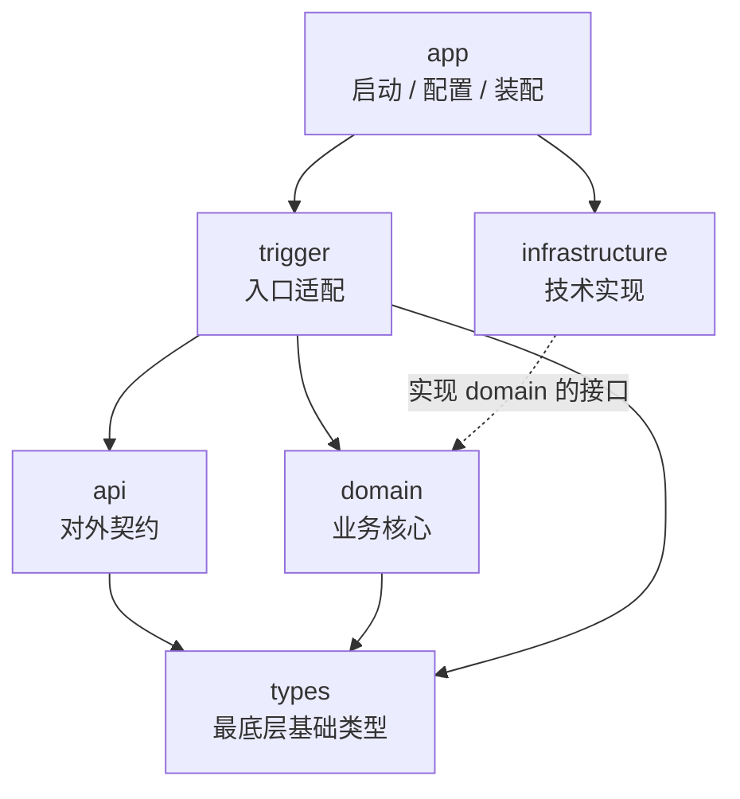

DDD 分层架构的价值不在目录看起来是否整齐，而在于用模块边界强制约束依赖方向，让业务逻辑独立于数据库、框架和外部接口。本文按“依赖方向 → 模块职责 → 领域包结构 → 请求链路 → 常见误区”的顺序展开。

## 一、先看依赖方向

分层架构的第一原则：**依赖只能由外向内，业务核心不依赖技术细节**。

箭头表示“可以依赖”：



换成模块视角：

| 模块 | 可以依赖 |
| --- | --- |
| types | 无（最底层） |
| api | types |
| domain | types |
| infrastructure | domain、types |
| trigger | api、domain、types |
| app | trigger、infrastructure（含传递依赖） |

关键约束只有一条：

> **domain 不允许依赖 infrastructure，也不允许依赖 trigger。**

数据库、HTTP 客户端、消息队列、缓存这些技术实现，对领域层来说都是“外部细节”。领域层只声明自己需要什么，具体由谁提供、怎么实现，交给外层。

表里 `api` 也指向 `types`，这条边常让人犹豫：契约层只放接口和 DTO，真的需要基础类型吗？答案是“允许依赖”，但不必强行使用。`types` 里放的是错误码、通用枚举、统一异常这类零依赖的共享类型；只要契约层的 `Response<T>` 或 DTO 字段引用了它们（比如响应体里携带错误码），`api` 就必须能依赖 `types`。如果某个业务域的 DTO 完全自包含、一个 `types` 里的类型都没用到，这条边不画也不违反约束——依赖图按实际引用收敛即可。唯一的前提是 `types` 保持零依赖、不混入业务逻辑，否则“共享内核”会变成新的耦合中心。

反过来，如果 `api` 打算作为独立 SDK 对外发布，就要连同 `types` 一起发布，或者让契约只依赖 JDK 类型。这是发布策略的取舍，不是分层方向的问题。

### 依赖倒置：接口归调用方所有

```java
// domain：只定义契约
public interface IOrderRepository {
    OrderAggregate findById(Long id);
    void save(OrderAggregate order);
}

// infrastructure：负责实现
@Repository
public class OrderRepository implements IOrderRepository {
    // MyBatis DAO、PO 转换、SQL 都收敛在这里
}
```

接口放在 domain，而不是 infrastructure，这就是依赖倒置：

- 领域层不关心实现，只关心能力；
- 技术实现可以替换（MySQL → 其他存储、HTTP → RPC）；
- 单元测试可以传入内存实现或 Mock，不启动数据库。

## 二、六个模块分别负责什么

| 模块 | 定位 | 典型内容 | 不该出现的东西 |
| --- | --- | --- | --- |
| types | 全项目共用的基础类型 | 错误码、统一异常、常量、通用枚举 | 业务逻辑、对上层模块的依赖 |
| api | 对外契约 | 服务接口、DTO、统一响应体 | 实现代码、数据库对象 |
| domain | 业务核心 | 聚合、实体、值对象、仓储接口、端口接口、领域服务 | SQL、MyBatis、HTTP 客户端、Controller 注解 |
| infrastructure | 技术实现 | DAO、PO、仓储实现、外部网关、缓存 / MQ 客户端 | 业务规则 |
| trigger | 入口适配 | Controller、定时任务、事件监听 | 业务编排、直接访问数据库 |
| app | 启动与装配 | 启动类、配置类、`application.yml` | 业务逻辑 |

几点容易混淆的地方：

- **api 是契约层，不是实现层。** 它描述“系统对外提供什么”，因此 trigger 依赖它；domain 不应出现 HTTP 请求 / 响应这类传输层概念。
- **types 要足够轻。** 它是所有层的地基，一旦引入 Web、ORM 等重依赖，就会把技术栈渗透到整个工程。
- **app 是唯一的装配点。** 具体用哪个实现、怎么注入，只在启动模块完成；其他层只面向接口编程。

## 三、domain 内部的包结构

一个业务域通常按“模型 / 适配器 / 服务”三部分组织：

| 包 | 中文 | 放什么 | 命名示例 |
| --- | --- | --- | --- |
| `model/aggregate` | 聚合 | 聚合根，聚合的一致性边界 | `OrderAggregate` |
| `model/entity` | 实体 | 有唯一标识、生命周期随业务变化的领域对象 | `OrderEntity` |
| `model/valobj` | 值对象 | 无标识、不可变、按值相等 | `MoneyVO`、枚举 |
| `adapter/repository` | 仓储接口 | 聚合的持久化契约 | `IOrderRepository` |
| `adapter/port` | 外部端口 | 需要外部系统提供的能力 | `IPaymentPort` |
| `service` | 领域服务 | 编排不属于单个实体的领域逻辑 | `IOrderService` / `OrderService` |

### 实体、值对象与聚合根

- **实体（Entity）**：有唯一标识，身份不变而属性可以变化，例如订单、用户。
- **值对象（Value Object）**：没有身份，只由属性值定义，应当不可变，例如金额、地址、时间区间。
- **聚合根（Aggregate Root）**：聚合对外的唯一入口，负责维护聚合内部的一致性。外部只能持有聚合根的标识，不能绕过它直接修改内部实体。

一个聚合应尽量小。聚合越大，并发冲突和事务范围越大；跨聚合的一致性通常通过领域事件或最终一致性解决，而不是把所有对象塞进一个大聚合。

### 仓储与端口的区别

- **仓储（Repository）**：面向聚合的持久化，语义接近“集合”，只负责存取，不暴露 SQL。
- **端口（Port）**：面向外部系统的能力，例如支付、短信、对象存储、第三方模型服务。

两者本质相同：都是领域层定义的接口，由基础设施层实现。区别只在“对内存储”还是“对外调用”。

## 四、infrastructure 如何对接

| 包 / 组件 | 作用 |
| --- | --- |
| `dao` + `dao/po` | MyBatis DAO 接口与持久化对象 |
| `adapter/repository` | 实现 domain 的仓储接口 |
| `adapter/port` | 实现 domain 的外部端口 |
| `gateway` | HTTP / RPC 客户端封装 |
| `redis` / `mq` | 缓存、消息等中间件配置与客户端 |

最重要的边界是 **PO 不能流出 infrastructure**：

```text
数据库表 ⇄ PO（持久化对象） ⇄ 转换 ⇄ 实体 / 聚合（领域对象）
```

PO 带的是表结构、ORM 注解和数据库字段；领域对象带的是业务语义。两者混用，表结构一变，业务代码就跟着改，分层也就名存实亡。

## 五、一次请求的完整链路

以“创建订单”为例：

```text
HTTP 请求
  │
  ▼
trigger/http/OrderController
  │  参数校验、DTO → 命令对象
  ▼
domain/service/OrderService
  │  业务规则、聚合编排、事务边界
  ▼
domain/adapter/repository/IOrderRepository   ← 接口
  │
  ▼
infrastructure/adapter/repository/OrderRepository   ← 实现
  │  PO ↔ 领域对象转换
  ▼
infrastructure/dao/IOrderDao
  │
  ▼
MySQL
```

返回方向：

```text
聚合 / 实体 → DTO（Assembler 转换）→ Response<T>
```

几条职责纪律：

- **Controller 只做三件事**：接收参数、校验、转换；不写业务判断，不直接调 DAO。
- **事务边界放在服务层**，由一次业务用例决定事务范围，而不是由 Controller 或 DAO 决定。
- **领域层不出现 SQL。** 需要什么数据，通过仓储接口表达。
- **读路径可以简化。** 简单列表、报表类查询允许绕过领域模型直接查 DAO；但写操作和核心业务规则必须经过领域层，否则聚合的不变量就没人守了。

## 六、这样分层解决了什么问题

1. **业务可测试。** 领域服务只依赖接口，用内存仓储或 Mock 就能跑单元测试，不需要数据库和 Web 容器。
2. **技术可替换。** 换数据库、换缓存、换外部服务，只改 infrastructure，domain 不动。
3. **边界可约束。** 依赖方向由 Maven 模块依赖强制保证，而不是靠口头约定或代码审查。
4. **业务维度清晰。** 六个模块是技术分层；domain 下的每个业务子包才是一个限界上下文，后续可以独立拆分。

要注意区分这两个维度：

```text
技术维度：types / api / domain / infrastructure / trigger / app
业务维度：domain/order、domain/payment、domain/user ...
```

只按技术分层、不按业务划分，最后会得到一个巨大的 domain 包，分层也就失去了意义。

## 七、新增一个业务域的标准步骤

1. 在 domain 下新建业务子包，例如 `order`。
2. 定义聚合根、实体、值对象，把不变量写在聚合根内。
3. 定义仓储接口；需要外部能力时定义端口接口。
4. 在 infrastructure 中补 PO、DAO、仓储实现与端口实现。
5. 编写领域服务，编排聚合与端口。
6. 在 api 中定义契约与 DTO。
7. 在 trigger 中增加 Controller。
8. 在 app 中完成 Bean 装配（多数情况下靠注解扫描即可）。

这本质上是“复制模板包 + 改名 + 填业务”的过程。模板的价值在于让每个业务域的结构一致，而不是让每个业务域都长得一样复杂。

## 八、常见误区

| 误区 | 表现 | 后果 |
| --- | --- | --- |
| 贫血模型 | 实体只有 getter / setter，业务逻辑全堆在 Service | 领域模型退化为数据袋，规则散落各处 |
| 领域层依赖技术实现 | domain 里 import MyBatis、HTTP 客户端、缓存客户端 | 无法单测，无法替换实现 |
| Controller 写业务 | 参数校验、业务判断、SQL 都在 Controller | 逻辑无法复用，事务边界混乱 |
| PO 当领域对象 | 表字段、ORM 注解直接出现在领域对象上 | 表结构变化直接冲击业务代码 |
| 为 CRUD 硬套 DDD | 简单增删改查也拆聚合、端口、领域事件 | 过度设计，维护成本远高于收益 |
| 循环依赖 | domain 与 infrastructure 互相依赖 | 模块无法独立编译，分层失效 |
| 只有目录没有约束 | 包名分了层，pom 依赖却随意引用 | 分层只是命名习惯，没有实际作用 |

## 九、检查清单

- [ ] domain 的 `pom.xml` 不依赖 infrastructure、trigger。
- [ ] domain 中没有 SQL、JDBC、ORM、HTTP 客户端。
- [ ] 仓储接口定义在 domain，实现在 infrastructure。
- [ ] 外部系统通过端口接口隔离，领域层不直接调用。
- [ ] Controller 只做参数校验与 DTO 转换。
- [ ] PO 不流出 infrastructure，领域对象与持久化对象分开。
- [ ] 聚合的业务不变量在聚合根内部维护。
- [ ] 跨聚合的一致性通过领域事件或最终一致性处理，而不是大事务。
- [ ] 模块依赖由构建工具强制，而不是靠约定。

## 十、一句话总结

DDD 分层的本质是 **依赖倒置 + 业务内聚**：用模块依赖锁住方向，用聚合守住一致性边界，用仓储和端口隔离技术细节。目录结构只是结果，不是目的。
