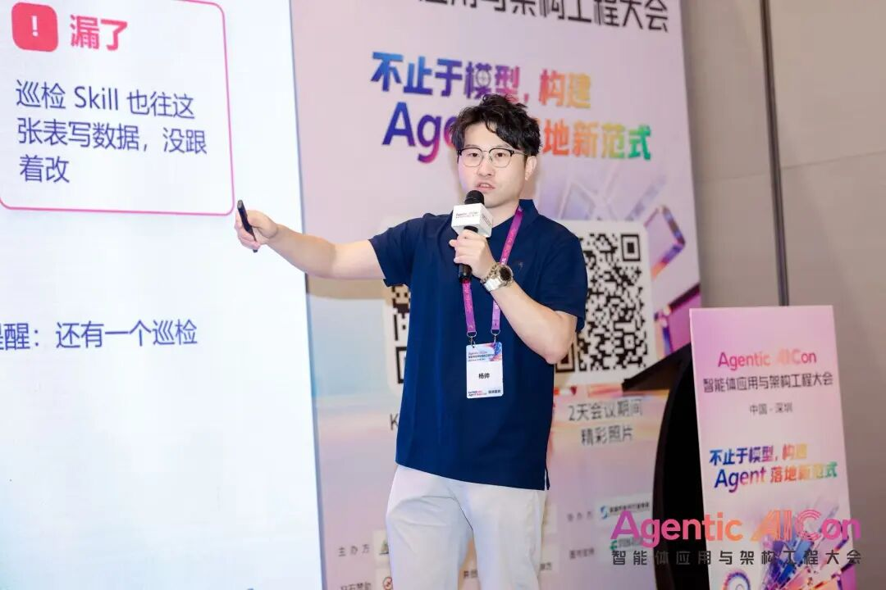
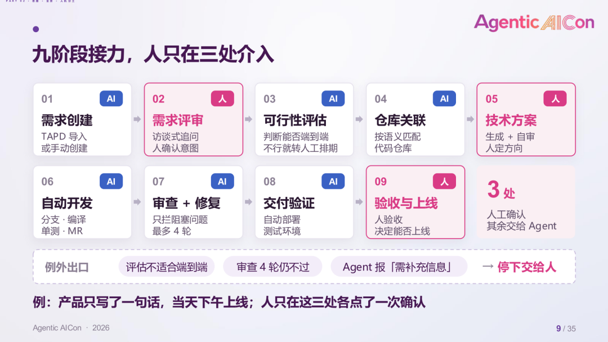
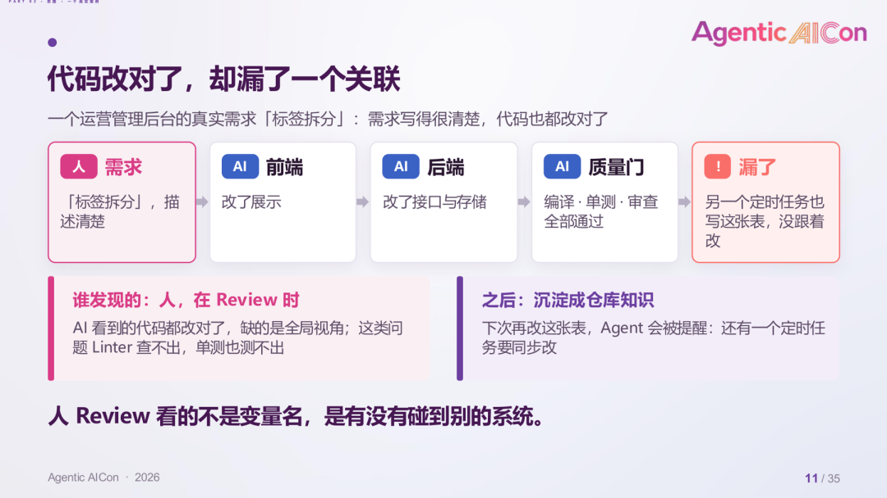
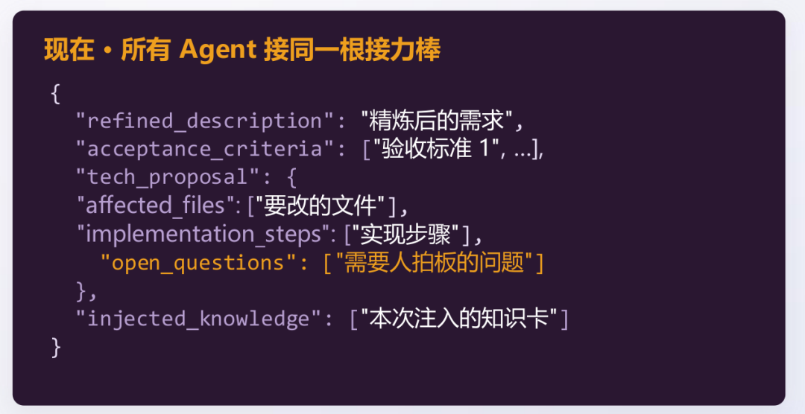
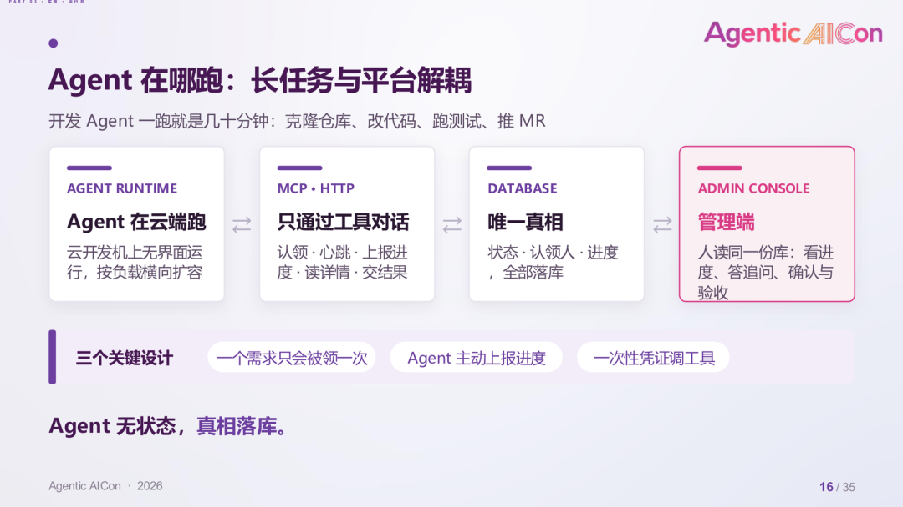
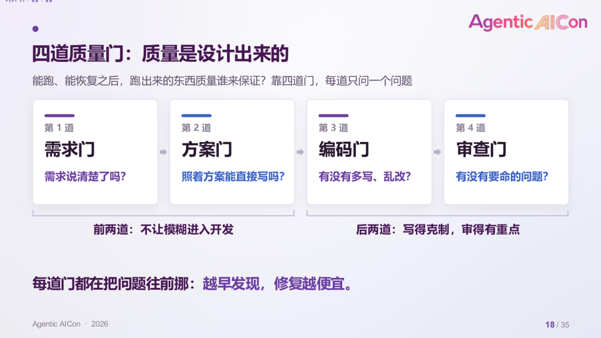
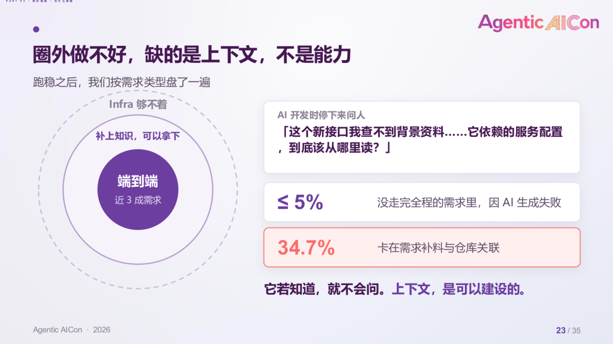
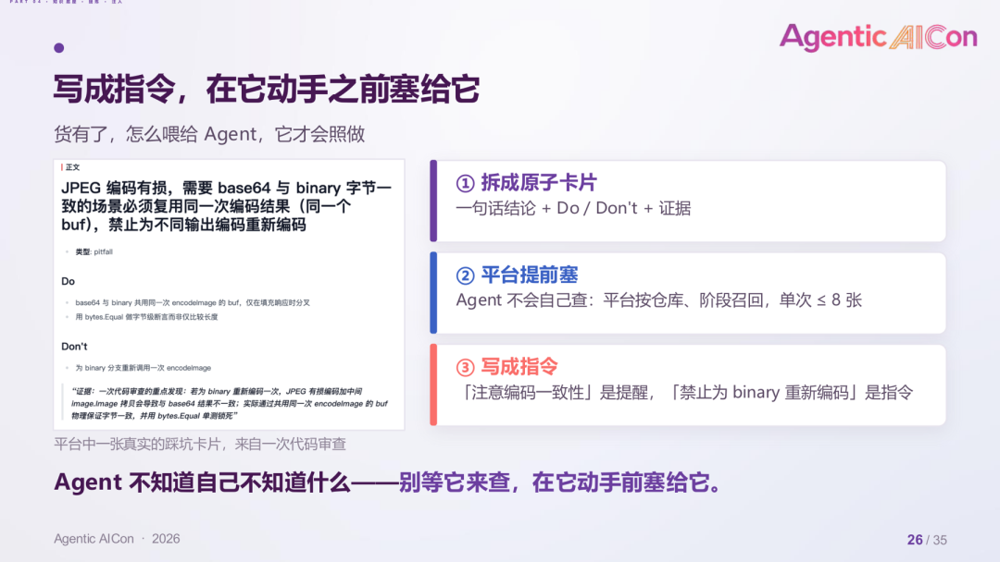
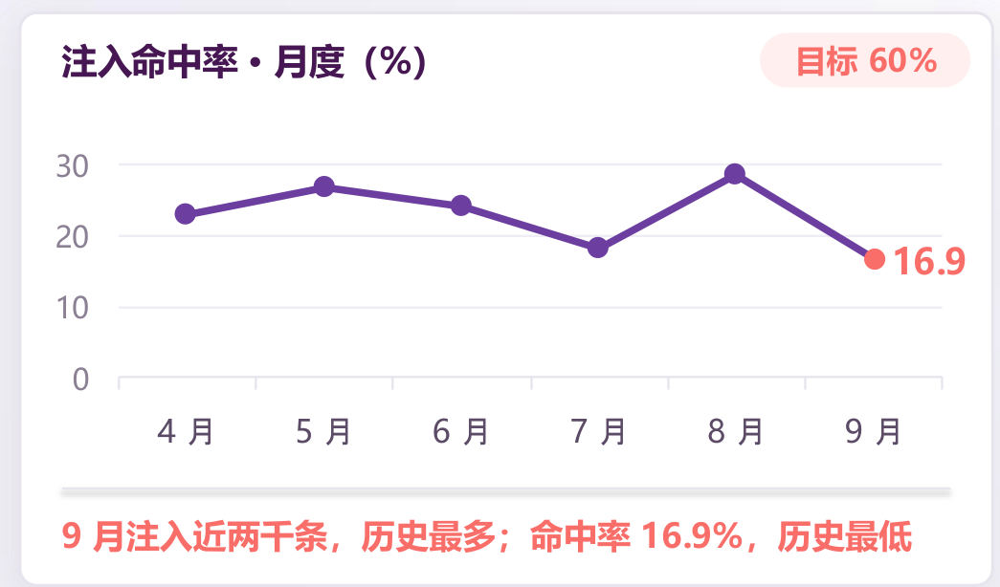
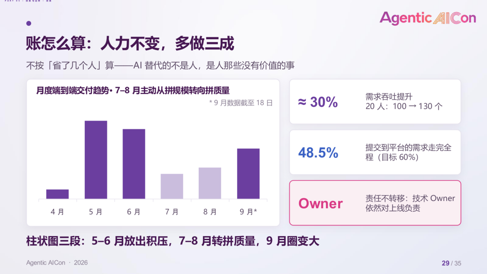

> 引用自：微信公众号「智能时代软件研发」 · [人只在三处介入：用多 Agent 重建研发流程｜Agentic AICon深圳站演讲实录](https://mp.weixin.qq.com/s/9_j-3b3nIsCkgImLKQBm3w)

**杨帅** · 智能时代软件研发 · *2026年11月13日 09:28*

本文整体自 Agentic AICon 深圳站，腾讯 PCG 社交安全中心高级后台开发工程师杨帅带来的关于《需求即交付：用多 Agent 端到端重建研发流程》主题分享。他所在的团队过去半年搭建了一套 AI 端到端交付平台，跑的全部是线上生产需求：截至 9 月，平台端到端交付了 335 个需求，单个需求中位耗时 106 分钟，AI 交付的代码未引发线上事故。

分享从一个判断出发：Coding Agent 写代码已经很快，但需求从提出到上线的整体周期没有同步缩短，原因在于流程里的大量环节是为"人的局限"设计的。团队沿着这个判断，把需求评审、技术方案、编码、审查、部署重新组织为九个阶段，用一份结构化 Spec 在 Agent 之间传递信息，用一台状态机串联全流程，人只在三个关键节点介入。

杨帅老师在分享中总结："当 AI 让某个环节变得多余，这个环节就该消失；当 AI 能承接执行层的工作，人就该把精力放到判断和创造上。"

以下内容整理自现场演讲，在保留原意的基础上略有删减。

## 一、问题出在哪：写代码变快了，交付没有变快

Coding Agent 的编码能力，这一年有目共睹。但一个需求从有人提出到真正上线，周期仍然按天甚至按周计算，环节之间依旧靠人一棒一棒传递。在每个环节里单点加入 AI，各环节都省一点时间，整体交付速度却提升有限。团队因此换了一个问法：做一个需求，真的需要这么多环节、开这么多会吗？这些环节，有多少只是因为人才存在？

### 1. 翻译官：开发是需求与 AI 之间的转译层

目前需求仍然排给具体的开发负责人，再由开发搭配一个 Agent 完成。以"帖子列表加载太慢，需要优化一下"这一最普通的需求为例：

- AI 手上有的：这一句话，加一个帖子服务的仓库。仓库之外的服务它看不到，容易就地加并发、加缓存。
- 开发脑子里有的：列表里每条帖子的作者信息来自另一个服务，该服务只有单查接口，一页要调用约 20 次。直接改并发，可能撞上限流，甚至拖垮下游。

开发会把需求翻译成两步：先让用户服务提供批量查询接口，再把帖子服务中的单查改为批量调用，最后把两个仓库一起交给 AI 执行。在这个过程中，开发承担的是"翻译官"的角色，把 AI 看不到的系统背景补给它，再把"列表慢"转成可执行的具体任务。

这里值得追问的是：这个翻译，只有人能做吗？

### 2. 传话游戏：每一次传递都在衰减

一个需求从用户反馈到上线，要经过七八道环节、七八双手，每个人按自己的理解转述一遍。用户说"操作太麻烦"，运营整理成"简化流程"，到产品手里变成"减少点击步骤"，三个人，三种说法。

对抗这种衰减，传统做法是开会：需求评审会、接口对齐会、联调周。很多会议开一下午，主要目的只有一个，确认大家说的是不是同一件事。

### 3. 零基追问：这个环节，是人的局限还是问题本身需要

团队用一个问题重新审视这些习以为常的环节：这个环节，是因为人的局限而存在，还是问题本身需要它？

| 环节 | 过去为什么存在 | AI 持有整条流程上下文之后 |
| --- | --- | --- |
| 前后端分离，开会对齐协议 | 一个人很难同时精通前端和后端 | AI 一次改完两端，协议对齐成为系统内部的事，对齐会本身不再需要 |
| 需求评审，来回拉会 | 传递链条太长，理解偏差只能靠人对齐 | Agent 之间通过一份结构化 Spec 流转必要信息，为对齐而开的会随之消失 |
| 联调，等两边开发凑齐 | 双方开发节奏不同，只能人等人 | 前后端在同一条流水线里由 Agent 交付，串行等待消失 |

由此得出一个区分：在每个环节里插入 AI，是加法，各环节各省一点；让一部分环节整体由 AI 接管，整条流程的效率则是乘数。后文所有设计，都围绕后一种做法展开。

## 二、流程重建：九个阶段、一份 Spec、一台状态机

### 1. 九阶段接力，人只在三处介入

重建后的流程可以概括为：九个阶段由多个 Agent 接力完成，阶段之间靠一份 Spec 传递信息，用一台状态机串联，人只在需求评审、技术方案、验收上线三处介入。

图 1 九阶段接力，人只在需求评审、技术方案、验收上线三处介入

以一个真实需求为例。产品在平台上只写了一句话："新建任务时，增加关联策略多选"，没有 PRD。

- **需求评审（人第一次介入）：** 评审 Agent 先用自己的话复述需求，再把拿不准的地方列成问题 @ 产品，产品回答后确认。
- **可行性评估：** 评估放在评审之后，是因为需求没问清楚，判断能否交给 AI 只能靠猜。评估只回答一件事，能否端到端完成，不能则转人工排期，不硬做。
- **仓库关联与技术方案（人第二次介入）：** Agent 匹配代码仓库、生成方案，技术负责人确认方向。方案阶段即使没有待确认的问题，也需要人点击确认才能进入开发。
- **开发、审查修复、部署测试环境：** 全部由 Agent 完成。
- **验收上线（人第三次介入）：** 当天下午，负责人验收并标记上线。

整个过程中，人在三个位置各确认一次，每次只花几分钟。流程并不总是这么顺利：评估不适合端到端、审查四轮仍不通过、Agent 发现缺少资料时，流程都会停下来，把决定交给人。

人工节点设得这么少，是踩坑踩出来的。人介入得太多，就等于没有自动化，所以节点要少，每一个都要放在真正需要人判断的地方。

### 2. 人做的四类判断：从执行者变成决策者

动手的事大多交给 Agent，人负责在关键位置做判断：

- **选方案：** 可维护性与性能怎么取舍，值不值得加缓存。AI 列出选项和利弊，技术负责人拍板。
- **补背景：** 老仓库的历史包袱、团队约定，大量没有写进文档。人补上一句，往往比反复调整 Prompt 更管用。
- **看异常：** AI 跑偏时，需要有人看得出来。
- **定价值：** 需求值不值得做、先做哪个，由人来定，定下之后由 AI 负责做好。

### 3. 案例：代码都改对了，却漏了系统之外的一个关联

在"看异常"上，团队遇到过一个典型案例。一个运营管理后台要做"标签拆分"，需求描述清晰。AI 改了前端展示，改了后端接口和存储，编译、单测、代码审查全部通过。

图 2 代码都改对了，却漏了系统之外的一个关联

到最后验收时，人发现了一个问题：系统之外还有一个定时任务，同样会往这张表写数据、调用这个接口。接口改了，这个任务也得同步修改，但它没有被改到。这类问题 Linter 查不出，单测也测不出，AI 在系统内改得都对，系统之外的东西它看不到。

发现之后让 AI 修复，这个问题同时沉淀为一条仓库知识。下一次再改这个接口，Agent 就知道仓库之外还有关联的任务需要一并修改。

这个案例说明了人在审查环节的位置：有了端到端交付和质量门之后，人审交付物不必再盯着实现细节，要看的是意图，以及有没有系统之外、AI 看不到的东西尚未改到。

### 4. 一份 Spec，Agent 之间不再"翻译"

九个 Agent 之间怎么传递信息，才不会再玩成一场传话游戏？团队的做法是传接力棒，这根接力棒是一份结构化的 Spec。

图 3 Spec 的主要字段，实际的比图中更详细

Spec 包含精炼后的需求描述、逐条验收标准、技术方案（要改哪些文件、按什么步骤改）、需要人拍板的问题与答案，以及本次注入的知识卡。它在流程推进中逐步补全，每个 Agent 读取自己关注的部分，并把需要留给后续环节的信息写入对应字段。

两点配套设计：

- **提需求的人不必一次写全：** 评审 Agent 会一轮轮追问并补全，再回写到 TAPD。一些与写代码无关的策略类需求，产品也会提到平台上来，为的是拿到一份经过追问的标准 PRD，再转人工处理。
- **Agent 之间不直接对话：** 两个 Agent 互相对话，过程很难把控。把需要流转的信息标准化为固定字段，信息才不会在传递中损耗。

### 5. 为什么用多 Agent 短循环，而不是一个长循环

有的团队会把整条流程交给一个 Agent 一路跑下去。边界清楚的编码任务，单个长循环非常合适。但研发流程很长，中间还要停下来等产品回答、等技术负责人确认，这时两种做法的差异就显现出来：

| 维度 | 单 Agent 长循环 | 多 Agent 短循环 + 状态机 |
| --- | --- | --- |
| 上下文 | 随步数持续膨胀，被强制压缩，信息丢失，后段注意力容易跑偏 | 每个 Agent 高内聚，只拿自己需要的字段，长度恒定 |
| 等待 | 等待挂在会话里，进程一退即丢；几十个需求同时在等，平台无法统一查进度、催办 | 等人记成库里的一条状态，挂一周回来照样知道从哪接着做 |
| 需求暂停 | 只能干等 | 上下文状态入库，下个月重新启动 |
| 分工 | 一个 Agent 包办全流程，调优互相牵扯 | 需求评审 Agent 可交给产品经理打磨，开发 Agent 可交给技术负责人注入开发 Skill 与团队规范，互不影响 |

因此，研发流程的自然形态是一台状态机。

### 6. 搭这套工作流的三件套

- **状态机：** 回答"下一步去哪，谁能把流程卡住"。目前共有 42 个状态，每一步的"在干活""在等人""失败了"各记为一个状态，其中等人的 9 个状态就是人工闸门。分得细，是因为恢复依赖它："修复中"与"审查中"分开记，崩溃后才知道该重放哪一步。多加一个顶层状态，前后端要同步改十来处映射，所以状态加得很克制。
- **上下文最小化：** 回答"每一步喂给 Agent 什么"。Agent 之间不传聊天记录，只传结构化字段和增量，知识单次最多 8 张卡。开发 Agent 不需要知道产品与评审 Agent 磨了几轮。
- **高内聚的 Agent：** 回答"这一步谁来干，怎么换"。每个 Agent 只做一件事，规范通过 Skill 迭代，改一处不影响别处。读取需求单、匹配仓库这类确定性任务，用输入输出固定的工作流；评审、开发、审查这类需要推理的环节，才用能自主规划的 Agent。

这三样与具体业务关系不大，换一个场景也能复用。

## 三、让流程在生产环境里跑稳

工作流跑不到生产环境里，就只是一个 demo。这一部分是团队投入最多的地方。

### 1. Agent 在哪里跑

开发 Agent 一次运行就是几十分钟，要克隆仓库、改代码、跑测试、推 MR，放在本机会占满 CPU，也可能把系统卡死。团队把 Agent 与平台拆开：

图 4 Agent 在云端运行，只通过工具与平台对话，状态全部落库

Agent 运行在云开发机上，无界面运行，按负载横向扩容，与平台之间只通过 MCP 和 HTTP 交互：领任务、报心跳、报进度、读详情、交结果。需求走到哪一步、谁领的、做到哪了，全部记在数据库里，这是唯一的真相，管理端上人看到的进度、答复追问、确认验收，读的也是同一份记录。

几个关键设计：一个需求只会被一个 Agent 领走，进度由 Agent 主动上报，调用工具凭一次性凭证。Agent 本身不存状态，所以它停了，平台仍能查到它做到了哪里。

### 2. 崩了，从最近的存档点接着跑

Agent 本质上是进程，随时可能死。思路类似游戏存档：中间状态全部记下，挂了从最近的存档点继续，不必从头重来。研发流程很长，每次从头跑成本太高。团队遇到并处理了三类故障，外加一个人工入口：

- **进程崩溃或发布重启：** 服务启动时扫描卡住的需求，按状态查表重放，拉起新的 Agent 重试。
- **多个实例抢同一个任务：** 用类似 CAS 的乐观锁，每次认领只有一个实例成功。
- **进程没死但失联（陷入死循环、工具怎么都调不通）：** Agent 定期上报心跳与进度，超时则放回重试一次，仍失败则告警，由负责人判断是系统问题还是 Agent 问题。
- **人要推倒重来：** 在管理端把状态退回到阶段入口。比如方案已走到代码审查，产品想改需求，把状态退回"需求评审中"重新走即可。

恢复不等于重跑。"修复中"崩溃后，重放的是代码审查而不是修复：修复可能已经提交，重新审查才能知道代码当前的真实状态。

### 3. 四道质量门：质量是设计出来的

图 5 四道质量门，每道只问一个问题

| 质量门 | 要回答的问题 | 关键做法 |
| --- | --- | --- |
| 需求门 | 需求说清楚了吗 | AI 在提问前先用自己的话复述需求，让人确认有无理解偏差。追问不走清单，顺着上一轮回答往下挖。放行前四件事必须明确：做什么、为谁做、规则是什么、怎么验收 |
| 方案门 | 照着方案能直接写吗 | 步骤按依赖排序：先建表，再写接口，再写逻辑，最后是调用方。单步改动超过 5 个文件就拆分，让每一步足够原子化；方案 Agent 用更强的模型，编码 Agent 因颗粒度小，用不着那么贵的模型。方案完成后让 AI 假设自己过度自信，再找一遍茬，把不确定的事尽量往前暴露 |
| 编码门 | 有没有多写、乱改 | 简单优先，三行重复的代码好过一个过早的抽象。范围纪律：只改方案里列出的文件，范围外发现的问题记录在变更摘要的"发现但不碰"里。AI 看到不合规范的旧代码会"顺手"修改，而每一处顺手都可能成为隐藏的 Bug |
| 审查门 | 有没有要命的问题 | Bug、崩溃、越权、数据错误必须修；风格偏好只提建议，不卡合并。以技术方案作为意图，逐条到代码里找证据。设六条安全硬底线，命中即打回 |

前两道门防的是模糊，后两道门防的是过度。每道门都在把问题往前移：AI 开发消耗的是部门成本，越早发现，修复越便宜。

审查门的分级也被问到过，是否意味着降低了质量标准。团队的回答是没有降，只是分级：该拦的一条不放，不该拦的不卡合并。这与 Google 代码评审规范的原则一致，变更确实提升了代码健康度，就不因不完美而阻塞。人还保留验收和上线两道关。

六条安全底线包括：用户维度的操作是否从登录态获取 UID 而非信任入参、新增接口是否接入鉴权、SQL 是否参数化、敏感信息是否进入代码与日志、外部入参是否在协议边界校验、资源访问是否校验归属。

### 4. 自动化要知道什么时候停

质量门挡住的是坏结果，还有一类问题更隐蔽：系统没坏，但一直在空转。

- **修复不收敛：** 审查、修复、再审查，修了这里坏了那里，不断循环且持续消耗 Token。团队设了上限，最多四轮，超过即 @ 技术负责人。
- **缺上下文、缺知识：** 缺对照表、缺配置时，Agent 硬想硬试，每一次尝试都在浪费 Token。正确做法是标注"需补充信息"并 @ 人。

这些护栏没有一条是让 AI 变聪明，它们的作用是在 AI 犯糊涂时，让系统及时停下来。自动化最难的一步，是知道什么时候该停，把决定交还给人。系统自己运行时之所以让人放心，也在于它出任何问题都会停下并 @ 人。

## 四、知识底座：决定这套流程能做多大

流程跑稳之后，瓶颈转移到了上下文与知识：AI 能做多少事，取决于给了它多少团队业务知识。

图 6 端到端能做的是中间一圈，圈外缺的是上下文

团队按需求类型做了一次盘点。最里面一圈，AI 能端到端完成，约占安全中心整体需求的近三成；最外面一圈，是基础设施够不着的部分，如无法接入的外部系统与配置系统，需要等基础设施补齐；真正值得关注的是中间一圈，AI 做到一半卡住，需要人补充。典型的情况是 AI 开发到一半停下来问："这个新接口我查不到背景资料，它依赖的服务配置，到底该从哪里读？"

数据印证了这一点：没有走完全程的需求中，因 AI 生成失败的不到 5%，34.7% 卡在需求补料和仓库关联上。补上上下文，AI 就能继续做，中间这一圈最有机会向外推。

### 1. 知识的第一个读者，变成了 Agent

知识的消费者从人变成 Agent，生产、形态、分发、维护都要随之改变：

| 维度 | 给人用的知识库 | 给 Agent 用的知识体系 |
| --- | --- | --- |
| 谁来写 | 靠人自觉写文档，或靠管理手段推动 | 流程节点自动沉淀，人只做纠偏。人在节点上补背景、做决策，这些补充本身就成为知识 |
| 写成什么 | 长文档，人能读懂 | 结构化卡片，上下文足够小、足够精确，人机共读 |
| 怎么用 | 用的时候再搜 | 动手之前就已注入。Agent 往往不知道自己不知道什么，不会主动去搜 |
| 怎么维护 | 只进不出 | 有进有出，到期退场。人能判断过期文档可能有误，Agent 会当真 |

传统知识库追求存得全，给 Agent 用的知识体系追求喂得准、淘汰得掉。

### 2. 知识从哪来：三个入口

- **仓库冷启动：** 仓库接入平台时做仓库级知识蒸馏，形成仓库画像，包括服务路径、技术架构、关键约定。画像不是替代读代码，代码仍然是最准确的事实，画像是一层索引与缓存，用来加速 AI 理解仓库，主干有新提交时增量刷新。
- **流程节点自动沉淀：** 评审、方案、审查、上线，每过一个节点自动产出知识。只有已上线并关联仓库的知识才会被引用。其中最有价值的是审查打回的问题，同一个坑反复出现，会升级为该仓库的约束，开发前注入，审查时逐条核对。
- **人补位时反哺：** 部门仍有大量需求靠人排期完成。团队提供 Skill 和命令行工具，人在自己的 IDE 里做完需求后调用 Skill，把整个过程反向沉淀到平台，整理出的背景与规范收回库里，下次同类需求 AI 就能直接使用。

### 3. 知识卡片：写成指令，在 Agent 动手之前注入

图 7 平台里的一张真实踩坑卡片，来自一次代码审查

图中是平台里的一张真实卡片，来自一次代码审查：一个图片接口需要同时返回 base64 与二进制，审查发现，若二进制分支再编码一次，JPEG 属于有损编码，两份结果会对不上。这条意见最终沉淀成卡片。卡片包含三个要素：

- **一句话结论：** 精简，只讲一件事。
- **Do 与 Don't：** 用指令方式写明该做什么、不能做什么。"注意编码一致性"只是提醒，"禁止为 binary 重新编码"才是指令，Agent 照着执行的是后者。
- **来源事实：** 这条知识来自哪个需求、哪个仓库。来源变了（业务形态变化、代码变化），卡片就应当退场，否则会变成冗余甚至错误的知识，比没有知识更糟。

注入方式上，团队一开始让 Agent 自己查，结果它几乎不查。现在改为平台在调用前，按仓库和阶段召回，单次最多 8 张，在 Agent 动手之前直接注入。

### 4. 多注入，不等于注得准

这是整场分享中杨帅特别强调的一个教训。

按直觉，知识越攒越多，注入的命中率应该越来越高。这里的命中率，是 Agent 回传的实际引用知识数与平台注入知识数之比。实际数据是：9 月注入近两千条，为历史最多，命中率却降到 16.9%，历史最低，离 60% 的目标差得很远。

图 8 注入命中率月度走势，9 月注入量最大，命中率最低

就像塞满的书架，书越多，要找的那一本反而越难找。

复盘的结论是两端不平衡：自动沉淀的生产端太强，同一件事被反复记录；提纯与取用的治理端太弱，召回只看相关，不看质量。注入越多，噪声越多，反而把 Agent 带偏。需要补上的是四件事：

- 查重合并：文字不同、语义相同的卡片合并。
- 召回后精排：把重复召回次数、人工审核结果计入权重。
- 只注入高置信度的知识。
- 过期自动退场：设有效期，到期且从未被引用的知识退出。

这四项目前仍在补建中，尚无可对外公布的效果数据。杨帅的建议是，做知识库的团队，第一天就把它们做进去，不要像他们一样等规模上来了再回头补。

## 五、效果与边界：账怎么算

### 1. 看需求吞吐，不看省了几个人

团队不按"省了几个人"计算，AI 替代的是人手上那些没有价值的事。可核算的指标是需求吞吐：剔除纯策略配置类需求之后，部门需求吞吐提升约 30%。打个比方，同样 20 个人，原来一个月做 100 个需求，现在能做 130 个。人力没有减，节省下来的精力投入架构、底层优化和团队 AI 基建。

图 9 月度端到端交付趋势，7 月和 8 月主动从拼规模转向拼质量（9 月数据截至 18 日）

月度走势可以分为三段：

- **4 月：** 灰度试用，需求不多。
- **5 至 6 月：** 平台开放给产品、运营使用后，迅速消化了长期积压在需求池里的 P2、P3 需求，交付量冲高。
- **7 至 9 月：** 积压消化完毕，团队主动从拼规模转向拼质量，同时补建知识底座。随着知识补齐，能做的范围变大，9 月回升。

另外两个数字：提交到平台的需求中，走完全程的占 48.5%，目标是 60%；AI 交付，责任不转移，上线质量仍由对应仓库的技术负责人把关。

需要注意的是，这几个比例的分母不同："近三成"是安全中心整体需求中 AI 能端到端承接的比例，48.5% 是提交到平台的需求中走完全程的比例，30% 是剔除策略配置类需求后的吞吐提升。

### 2. 能力边界：看上下文，不看大小

团队判断一个需求能否交给 AI 的依据只有一条：所有相关仓库的改动契约，现在能不能一次定清楚。上下文能拿全，工作量再大也能做（曾有一个需求，AI 评审预估三天，实际一小时内完成）；上下文拿不全，再小的需求也要交给人。

**走端到端：上下文能拿全**

- 改动落在单个仓库内，方案、依赖、规范可一次给齐
- 改动契约能一次定清楚，以管理后台、配置、查询类为主
- 风险较小的系统，工作量大也能做

**交给人：上下文拿不全**

- 对接外部系统：AI 的手伸不出去
- 架构重构：人工参与常超过七成，端到端不划算
- 安全核心判定逻辑：按规范不交给 AI
- C 端需求：验证面广，已改为人机协同

这一边界是动态的，知识补上一块，能力圈就大一圈。

### 3. 下一个瓶颈：验收

开发周期从天压缩到小时，验证仍要等人有空，验收成为新的瓶颈。团队有两个尝试：

- **端到端自动测试：** 内网管理端的页面，已经能用 Computer Use、Playwright 等方式自动点测；后台服务和客户端目前还难以完全覆盖。
- **测试左移：** 谁对发布负责，谁来验。后台服务由开发按风险分级验证，管理端功能让提需求的产品、运营在测试环境里自己体验确认后再发布。

这里存在效率与质量的取舍。左移只适用于可容忍小问题的内部场景，约占三成需求，To C 这类用户零容忍的场景仍需严格测试。

## 六、落地建议

如果希望在自己的团队中借鉴这套做法，杨帅给出三点：

- **从一个具体场景切入，先跑通：** 团队从安全中心的运营管理端起步，这类需求量大、风险低、验收快。跑起来比任何前置设计都重要，再逐步扩大到架构设计、多仓库联动乃至 To C。
- **骨架照搬，参数自调：** 状态机、上下文最小化、高内聚 Agent 这三样与业务关系不大；状态设计多少个、Agent 里写哪些 Skill 与团队规范、人工节点放在哪、质量门怎么设，要按自己的流程来。
- **建知识底座之前，先回答四个问题：** 服务什么场景，谁来使用，库里装什么，怎么算成功。知识注入命中率就是团队的成功指标之一。

## 结语

回到开头的问题：AI 能承接更多工作以后，研发流程要不要变？团队这半年的答案是，要变，而且要重建。让 Agent 接住整个需求，需要交代清楚背景，把流程接起来，还要明确它在哪里停下，等人判断。

这套做法有清晰的适用范围：目前覆盖的主要是内部管理后台、配置与查询类需求，对外的 C 端、安全核心判定逻辑、架构重构仍由人主导；知识体系的治理刚刚起步，验收环节正在成为新的瓶颈。但沿着"哪些环节是为人的局限而存在"这个问题往下追问，得到的是一种可以迁移的思路，而不限于某个团队的某套工具。

> 当 AI 让某个环节变得多余，
> 这个环节就该消失。

## 作者简介

杨帅（danteyang），腾讯 PCG 社交安全中心高级后台开发工程师，部门 AI Agent 专项负责人。2018 年加入腾讯，长期负责 QQ 社交安全领域的后台研发。近年聚焦 Agent 工程化与 AI 原生研发，主导搭建安全中心 AI 端到端研发平台，以多 Agent 接力与状态机编排，把需求评审、技术方案、编码、代码审查、测试部署串成一条流水线，并牵头建设部门的 AI 知识体系。

如果你身边有正在被"AI 提效了但交付没变快"困扰的团队，欢迎把这篇文章转给他们。这套东西最值钱的不是工具，是那句追问——哪些环节只是因为人才存在。
