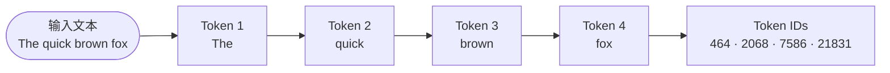
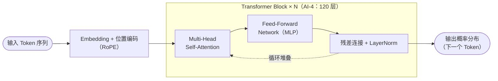
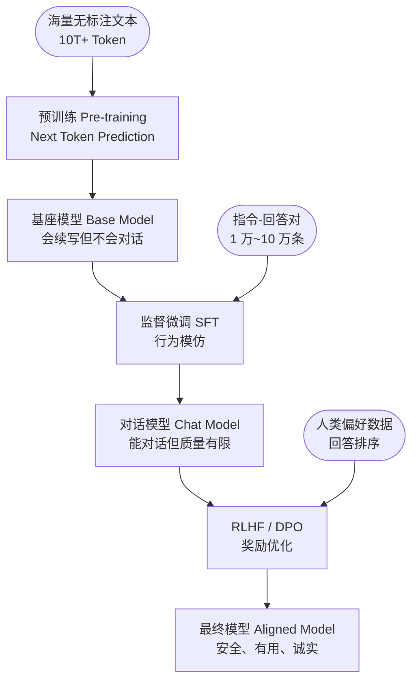
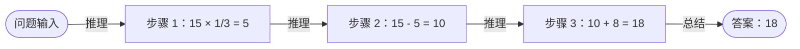
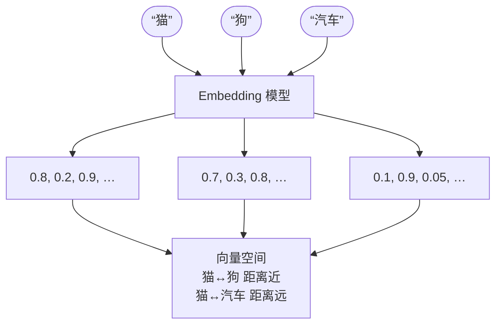
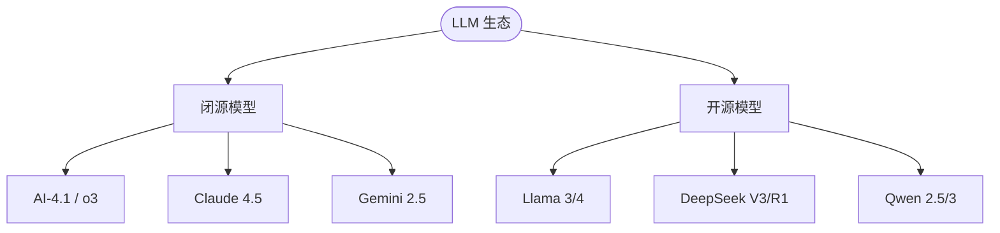

理解 LLM 的核心概念，把握从 ChatBot 到 Agent 的跃迁路径

🧭 本章先抓住这条主线

很多小白一上来就被 Token、Prompt、Embedding、Function Calling 这些词绕晕。其实你只要按一条线理解就够了：

**Token** 解释模型如何看文本， **Prompt** 解释你如何对模型下指令， **Embedding** 解释模型如何找回知识， **Function Calling** 和 **思维框架** 解释模型如何从"只会说话"变成"能办事情"。

读完本章的最低目标不是背概念，而是能回答这些核心问题：模型怎么计费、为什么 Prompt 会影响结果、RAG 为什么要 Embedding、Function Calling 的作用是什么、四种思维框架的递进关系是什么。 **本章只讲核心概念，工程细节在后续章节展开** 。

🎤 面试官更爱这样追问

比起问"什么是 Token"，更真实的问法通常是：

- 为什么同样一段中文比英文更贵？
- Prompt 明明只改了几句话，为什么效果会变化这么大？
- 为什么 RAG 不直接全文塞进上下文，而要先做 Embedding 检索？

## 1.1 Token：AI 的"字"

如果你问我学 AI 最先该搞懂什么，我会说： **Token** 。这是整个大模型世界的最小度量单位，就像物理学里的原子、编程里的字节。你不理解 Token，就无法理解模型的定价、上下文窗口、速度限制，甚至连写 Prompt 的优化方向都是错的。

简单来说， **Token 是大语言模型处理文本的基本单位** 。但 Token 不等于"一个字"，也不等于"一个词"——它介于两者之间，由分词器（Tokenizer）根据 BPE（Byte Pair Encoding）算法自动切分。切分规则取决于模型使用的词表，不同模型的词表不同，Token 粒度也不同。

举个例子，同样一句话"我爱学习人工智能"，AI-4 的 Tokenizer 可能切分为 6 个 Token，而 Claude 可能切分为 4 个。这就是为什么同样长的文本在不同模型上的费用不同——计费是按 Token 数算的，不是按字符数。

### 中英文 Token 差异

一个让很多开发者困惑的现象：同样 1000 字的内容，中文比英文贵不少。原因在于主流模型的词表以英文为核心，一个英文单词通常对应 1-1.3 个 Token，而一个中文字符大约对应 1.5-2 个 Token。这意味着中文内容的 Token 密度更高，成本也更高。

📊 中英文 Token 对照示例

| 文本内容 | 字符数 | AI-4.1 Token 数 | 每字符 Token 比 |
| --- | --- | --- | --- |
| Hello World | 11 | 2 | 0.18 |
| The quick brown fox jumps | 25 | 5 | 0.20 |
| 你好世界 | 4 | 4-6 | 1.0-1.5 |
| 我爱学习人工智能 | 8 | 8-12 | 1.0-1.5 |
| 人工智能是未来（含标点） | 9 | 10-14 | 1.1-1.6 |

### 上下文窗口：模型的"记忆容量"

每个大模型都有一个硬性限制： **上下文窗口大小** 。它表示模型一次能"看到"的最大 Token 数量，包括输入和输出。如果总 Token 数超过窗口大小，多余的部分会被截断或需要特殊处理。上下文窗口直接决定了 Agent 能处理多复杂的任务——窗口太小，多轮对话和长文档处理就受限。

📊 主流模型上下文窗口对比

| 模型 | 上下文窗口 | 约等于中文字数 | 适用场景 |
| --- | --- | --- | --- |
| AI-4.1 | 1M | ~670K 字 | 长文档分析、代码理解 |
| AI-4.1-mini | 1M | ~670K 字 | 高性价比长文本处理 |
| Claude Sonnet 4.5 | 200K (可扩展1M) | ~130K 字 | 超长文档、Agent 编程 |
| Gemini 2.5 Pro | 1M | ~670K 字 | 整本书、视频分析 |
| DeepSeek-V3 | 128K | ~85K 字 | 高性价比通用推理 |
| Qwen 2.5 | 128K | ~85K 字 | 中文优化场景 |

### Token 计费模型：Input vs Output

几乎所有主流模型都采用 **分开计费** 的模式：输入 Token（Input Token）和输出 Token（Output Token）价格不同，而且输出通常贵 3-4 倍。这个设计逻辑很合理——输入只是"读"，输出需要"生成"，生成的计算量远大于读取。

对于 Agent 开发者来说，这意味着： **控制输出长度比控制输入长度更省钱** 。一个常见误区是拼命压缩 Prompt（输入），却让模型输出了大量废话。实际上，让模型输出简洁结果、用结构化格式约束输出长度，优化效果更好。

💰 主流模型 Token 价格对比（每百万 Token）

| 模型 | Input ($/M) | Output ($/M) | Output/Input 倍数 | 性价比评级 |
| --- | --- | --- | --- | --- |
| AI-4.1 | $2.00 | $8.00 | 4x | 中 |
| AI-4.1-mini | $0.40 | $1.60 | 4x | 高 |
| Claude Sonnet 4.5 | $3.00 | $15.00 | 5x | 中 |
| Gemini 2.5 Pro | $1.25 | $10.00 | 8x | 高 |
| DeepSeek-V3 | $0.27 | $1.10 | 4x | 极高 |
| Qwen 2.5 (开源) | $0.15 | $0.60 | 4x | 极高 |

### Token 优化策略

在 Agent 开发中，Token 优化直接影响成本和响应速度。核心策略有四个： **压缩 Prompt** （去掉冗余描述，用精炼指令）、 **缩短输出** （要求模型只输出关键信息）、 **缓存复用** （对相同 Prompt 缓存结果，OpenAI 的 Prompt Caching 可节省 50% 输入成本）、 **分段处理** （长文档分段处理，避免一次塞满上下文）。

```python
# Token 优化前后对比示例

# ❌ 冗长 Prompt（约 200 Token）
prompt_bad = """
你是一个非常专业的翻译专家，精通中文和英文的翻译工作。
你的任务是将用户提供的中文文本翻译成英文。
翻译时请注意保持原文的语气和风格。
请确保翻译准确，不要遗漏任何信息。
如果遇到专业术语，请使用通用的英文表达。
翻译完成后，请简要说明你的翻译思路和用词选择理由。
"""

# ✅ 精炼 Prompt（约 40 Token）
prompt_good = "将以下中文翻译为英文，保持语气一致："

# 节省约 80% Input Token，且输出更简洁
```



### Token 消耗实战估算：1000 行代码 ≈ 多少 Token？

面试中常被追问： **"写一千行代码大概消耗多少 token？一次 Agent 对话大概花多少钱？"** 很多人只知道"按 token 计费"，但给不出具体数字。这节帮你建立直觉。

#### 📏 代码行 → Token 换算规则

不同语言的代码，Token 密度差异很大。核心换算公式：

📊 代码 Token 密度对照表

| 语言/内容 | 1行 ≈ Token数 | 1000行 ≈ Token数 | AI-4.1 输入成本 |
| --- | --- | --- | --- |
| Python（简洁风格） | ~15 Token | ~15,000 Token | $0.030 |
| Java（冗长风格） | ~25 Token | ~25,000 Token | $0.050 |
| 中文文档/注释 | ~20 Token | ~20,000 Token | $0.040 |
| 英文文档/注释 | ~10 Token | ~10,000 Token | $0.020 |
| JSON/配置文件 | ~12 Token | ~12,000 Token | $0.024 |

估算公式：Token 数 ≈ 字符数 ÷ 4（英文）或 字符数 ÷ 2（中文）。Python代码偏英文密度，1行≈15 Token；Java冗长1行≈25 Token。

**关键结论** ：1000 行 Python 代码大约消耗 15,000 Token，在 AI-4.1 上输入成本约 $0.030（约3美分）。但如果模型需要 **生成** 1000行代码（输出Token），成本约 $0.15（输出价格是输入的4倍）。

#### 💰 典型 Agent 场景 Token 消耗案例

🎯 五种典型场景的 Token 消耗与成本

| 场景 | 输入Token | 输出Token | AI-4.1 总成本 | AI-4.1-mini 总成本 |
| --- | --- | --- | --- | --- |
| 简单问答（1轮） | ~500 | ~200 | $0.003 | $0.0002 |
| 代码解释（读+解读） | ~3,000 | ~1,500 | $0.023 | $0.0014 |
| 代码修改（定位+改+输出） | ~8,000 | ~4,000 | $0.060 | $0.0036 |
| 复杂开发（5轮工具调用） | ~50,000 | ~15,000 | $0.275 | $0.0165 |
| 全项目重构（20轮+） | ~200,000 | ~60,000 | $1.100 | $0.066 |

成本计算公式：总成本 = 输入Token×输入单价 + 输出Token×输出单价。AI-4.1: $2.0/M输入 + $8/M输出；AI-4.1-mini: $0.40/M输入 + $1.60/M输出。

面试回答 Token 消耗时， **记住三个锚点** ：①简单问答≈500 Token ≈ $0.003；②代码修改≈8000 Token ≈ $0.06；③复杂Agent任务≈50K Token ≈ $0.27。然后说"具体取决于对话轮数和工具调用次数"，这就够了。

#### 📜 百万 Token 计费规则详解

主流 API 的计费不是简单的"每千字多少钱"，而是有精细的规则：

📋 计费规则五条核心

1. **输入和输出分别计费** ：输入Token（你发给模型的）和输出Token（模型返回的）价格不同，输出通常是输入的3-5倍。如AI-4.1输入$2.0/M、输出$8/M（4倍）。
2. **缓存Token半价** ：OpenAI 和 Anthropic 都支持 Prompt Caching——重复出现的输入前缀可以缓存，缓存命中的Token价格约为正常输入的50%。如AI-4.1缓存输入$1.0/M（正常的一半）。
3. **按实际消耗计费，不按字符** ：计费单位是Token而非字符。同样1000字符，中文比英文消耗更多Token，所以中文费用更高。
4. **工具调用的Token也算** ：Function Calling返回的JSON参数是输出Token，工具执行结果是输入Token（下次发给模型）。一个5轮工具调用的Agent任务，Token消耗是累积的。
5. **流式输出不省钱** ：Streaming模式只是"边生成边返回"让用户感觉更快，Token总数和费用与非流式完全相同。

```python
def estimate_agent_cost(
    system_prompt_tokens: int = 500,
    tool_schemas_tokens: int = 2000,
    memory_inject_tokens: int = 3000,
    rounds: int = 5,
    avg_input_per_round: int = 1000,
    avg_output_per_round: int = 800,
    model: str = "ai-4o"
):
    """估算 Agent 任务的 Token 消耗和成本"""
    pricing = {
        "ai-4o":      {"input": 2.50,  "output": 10.00, "cached": 1.25},
        "ai-4o-mini": {"input": 0.15,  "output": 0.60,  "cached": 0.075},
        "claude-3.5":  {"input": 3.00,  "output": 15.00, "cached": 1.50},
    }
    p = pricing[model]
    
    # 第一轮：System Prompt + 工具Schema + 记忆注入 + 用户输入
    first_input = system_prompt_tokens + tool_schemas_tokens + memory_inject_tokens + avg_input_per_round
    # 后续轮次：缓存System Prompt前缀 + 新增内容 + 工具返回
    later_input = avg_input_per_round * (rounds - 1)  # 每轮工具返回也算输入
    
    total_input = first_input + later_input
    total_output = avg_output_per_round * rounds
    
    # 假设50%的输入可命中缓存
    cached_input = int(total_input * 0.5)
    fresh_input = total_input - cached_input
    
    cost = (fresh_input * p["input"] / 1_000_000
          + cached_input * p["cached"] / 1_000_000
          + total_output * p["output"] / 1_000_000)
    
    return {
        "total_input_tokens": total_input,
        "total_output_tokens": total_output,
        "cached_tokens": cached_input,
        "estimated_cost_usd": round(cost, 4),
        "per_round_avg": round(total_input + total_output / rounds),
    }

# 示例：5轮代码修改任务，AI-4.1
result = estimate_agent_cost(rounds=5, model="ai-4o")
# → {"total_input": 11500, "total_output": 4000, "cost": "$0.059"}

# 示例：20轮全项目重构，AI-4.1-mini
result = estimate_agent_cost(rounds=20, model="ai-4o-mini")
# → {"total_input": 24500, "total_output": 16000, "cost": "$0.014"}
```

```java
// Token 消耗估算工具
import java.util.*;

public class TokenCostEstimator {
    public static Map<String, Double> estimateAgentCost(
            int systemPromptTokens, int toolSchemasTokens, int memoryInjectTokens,
            int rounds, int avgInputPerRound, int avgOutputPerRound, String model) {
        if (systemPromptTokens == 0) systemPromptTokens = 500;
        if (toolSchemasTokens == 0) toolSchemasTokens = 2000;
        if (memoryInjectTokens == 0) memoryInjectTokens = 3000;
        if (rounds == 0) rounds = 5;
        if (avgInputPerRound == 0) avgInputPerRound = 1000;
        if (avgOutputPerRound == 0) avgOutputPerRound = 800;
        if (model == null || model.isEmpty()) model = "ai-4o";

        Map<String, Double> pricing = Map.of(
            "ai-4o",      2.50,
            "ai-4o-mini", 0.15,
            "claude-3.5",  3.00
        );
        double inputPrice = model.equals("ai-4o") ? 2.50 : model.equals("ai-4o-mini") ? 0.15 : 3.00;
        double outputPrice = model.equals("ai-4o") ? 10.00 : model.equals("ai-4o-mini") ? 0.60 : 15.00;
        double cachedPrice = inputPrice / 2;

        // 第一轮：System Prompt + 工具Schema + 记忆注入 + 用户输入
        int firstInput = systemPromptTokens + toolSchemasTokens + memoryInjectTokens + avgInputPerRound;
        int laterInput = avgInputPerRound * (rounds - 1);

        int totalInput = firstInput + laterInput;
        int totalOutput = avgOutputPerRound * rounds;

        // 假设50%的输入可命中缓存
        int cachedInput = totalInput / 2;
        int freshInput = totalInput - cachedInput;

        double cost = freshInput * inputPrice / 1_000_000
            + cachedInput * cachedPrice / 1_000_000
            + totalOutput * outputPrice / 1_000_000;

        Map<String, Double> result = new LinkedHashMap<>();
        result.put("total_input_tokens", (double) totalInput);
        result.put("total_output_tokens", (double) totalOutput);
        result.put("cached_tokens", (double) cachedInput);
        result.put("estimated_cost_usd", Math.round(cost * 10000) / 10000.0);
        result.put("per_round_avg", (double) (totalInput + totalOutput / rounds));
        return result;
    }

    public static void main(String[] args) {
        // 示例：5轮代码修改任务，AI-4.1
        Map<String, Double> result1 = estimateAgentCost(0, 0, 0, 5, 0, 0, "ai-4o");
        System.out.println(result1);
        // → {total_input: 11500, total_output: 4000, cost: "$0.059"}

        // 示例：20轮全项目重构，AI-4.1-mini
        Map<String, Double> result2 = estimateAgentCost(0, 0, 0, 20, 0, 0, "ai-4o-mini");
        System.out.println(result2);
        // → {total_input: 24500, total_output: 16000, cost: "$0.014"}
    }
}
```

### 上下文窗口 Token 经济学：分配、缓存与优化

面试追问： **"上下文窗口128K，系统提示词占了多少？剩下的怎么分配？怎么设计才能更有效命中缓存？"** 这节从经济学视角拆解上下文窗口的每一份 Token 预算。

#### 📊 上下文窗口的 Token 分配策略

一个 128K 的上下文窗口，看起来很大，但在 Agent 场景下很快就会被填满。来看一个典型的分配：

🧮 128K 上下文窗口的典型 Token 分配

| 组成部分 | 典型Token数 | 占比 | 性质 | 缓存友好度 |
| --- | --- | --- | --- | --- |
| System Prompt（角色+规则） | 500~2,000 | 0.4~1.6% | 🔒固定不变 | ✅ 最易命中缓存 |
| 工具Schema（Function Calling定义） | 1,000~5,000 | 0.8~4% | 🔒固定不变 | ✅ 最易命中缓存 |
| Skill触发词（available\_skills列表） | 500~3,000 | 0.4~2.3% | ⚠️缓慢变化 | ⚠️ 多轮后命中 |
| 记忆注入（长期记忆召回片段） | 1,000~5,000 | 0.8~4% | ⚠️按需动态 | ❌ 不可缓存 |
| 对话历史（多轮交互记录） | 5,000~50,000+ | 4~39% | 🔄逐轮增长 | ❌ 不可缓存（新内容） |
| 工具返回结果（Action输出） | 2,000~20,000 | 1.6~16% | 🔄每轮新增 | ❌ 不可缓存 |
| 模型输出预留 | 剩余空间 | 30~50% | 📝模型生成用 | — |

关键发现：System Prompt + 工具Schema + Skill触发词合计仅占 2~8%，但每次请求都要发送。缓存命中这部分可以节省 50%+ 的输入成本。

面试中回答"上下文窗口怎么分配"时， **先说固定部分再说动态部分** ："System Prompt + 工具Schema + Skill触发词是固定的（2~8%），缓存命中后半价；记忆注入和对话历史是动态的（20~55%），不可缓存但可以通过压缩和召回控制。预留30~50%给模型输出。"然后强调：固定前缀放最前面，最大化缓存命中率。

#### 🎯 Prompt Cache：如何更有效命中缓存

OpenAI 的 **Prompt Caching** （前缀缓存）机制：当多个请求的 Prompt 前缀相同时，系统会缓存前缀的 KV 计算结果，后续请求只需计算新增部分。缓存命中的 Token 价格约为正常的 **50%** 。

缓存命中条件： **前缀完全相同** 。任何一字之差都会导致缓存失效，从零开始计算。所以设计的关键是 **把不变的放前面，变化的放后面** 。

🏗️ 缓存友好的 Prompt 结构设计

**✅ 正确顺序（最大化缓存命中）：**

1. System Prompt（角色 + 规则）—— 🔒 每次相同，缓存 100% 命中
2. 工具 Schema（Function 定义）—— 🔒 每次相同，缓存 100% 命中
3. Skill 触发词（available_skills）—— ⚠️ 同会话内相同，缓存命中
4. 记忆注入（长期记忆片段）—— ❌ 每轮可能不同，不命中
5. 对话历史（多轮记录）—— ❌ 逐轮增长，旧部分可命中
6. 用户当前输入 —— ❌ 每次不同，不命中

**❌ 错误顺序（缓存命中率低）：**

1. 用户当前输入 —— ❌ 放最前面，每轮都不同
2. 对话历史 —— ❌ 紧随用户输入，缓存难命中
3. 工具 Schema —— 🔒 被挤到后面，前缀变了缓存失效
4. System Prompt —— 🔒 放最后面，缓存完全失效

```python
def build_cache_friendly_prompt(system_msg, tools_schema, skills_desc, 
                                memory_chunks, chat_history, user_input):
    """按缓存友好顺序组装 Prompt
    原则：固定前缀放最前面，动态内容放后面"""
    messages = []
    
    # Layer 1: 固定层（100%缓存命中）
    # System Prompt + 工具定义放最前面
    system_content = f"{system_msg}\n\n# Available Tools\n{tools_schema}\n\n# Available Skills\n{skills_desc}"
    messages.append({"role": "system", "content": system_content})
    
    # Layer 2: 半固定层（同会话内缓存命中）
    # 长期记忆注入（同会话内召回策略变化不频繁）
    if memory_chunks:
        memory_block = "\n".join([f"- {m}" for m in memory_chunks])
        messages.append({"role": "system", "content": f"# Recalled Memory\n{memory_block}"})
    
    # Layer 3: 动态层（不命中缓存但旧部分可命中）
    # 对话历史 + 工具返回结果
    for msg in chat_history:
        messages.append(msg)
    
    # Layer 4: 当前请求（完全不命中缓存）
    messages.append({"role": "user", "content": user_input})
    
    return messages

# 缓存命中率估算
# 假设: 固定层2000token + 半固定层2000token + 10轮对话8000token + 当前500token
# 第5轮请求: 前缀(2000固定+8000对话旧部分)可缓存 ≈ 50%命中率
# 第10轮请求: 前缀(2000固定+16000对话旧部分)可缓存 ≈ 70%命中率
# 成本节省: 50%~70%的输入Token按半价计费
```

```java
// 按缓存友好顺序组装 Prompt
// 原则：固定前缀放最前面，动态内容放后面
import java.util.*;

public class CacheFriendlyPromptBuilder {
    public static List<Map<String, String>> buildCacheFriendlyPrompt(
            String systemMsg, String toolsSchema, String skillsDesc,
            List<String> memoryChunks, List<Map<String, String>> chatHistory, String userInput) {
        List<Map<String, String>> messages = new ArrayList<>();

        // Layer 1: 固定层（100%缓存命中）
        String systemContent = systemMsg + "\n\n# Available Tools\n" + toolsSchema
            + "\n\n# Available Skills\n" + skillsDesc;
        messages.add(Map.of("role", "system", "content", systemContent));

        // Layer 2: 半固定层（同会话内缓存命中）
        if (memoryChunks != null && !memoryChunks.isEmpty()) {
            String memoryBlock = String.join("\n",
                memoryChunks.stream().map(m -> "- " + m).toList());
            messages.add(Map.of("role", "system", "content", "# Recalled Memory\n" + memoryBlock));
        }

        // Layer 3: 动态层（不命中缓存但旧部分可命中）
        messages.addAll(chatHistory);

        // Layer 4: 当前请求（完全不命中缓存）
        messages.add(Map.of("role", "user", "content", userInput));

        return messages;
    }
}

// 缓存命中率估算
// 假设: 固定层2000token + 半固定层2000token + 10轮对话8000token + 当前500token
// 第5轮请求: 前缀(2000固定+8000对话旧部分)可缓存 ≈ 50%命中率
// 第10轮请求: 前缀(2000固定+16000对话旧部分)可缓存 ≈ 70%命中率
// 成本节省: 50%~70%的输入Token按半价计费
```

✅ 面试要点

回答"如何更有效命中缓存"时，三句话搞定：  
  
**① 固定前缀放最前**——System Prompt + 工具Schema + Skill描述放在Prompt开头，保证每轮前缀一致，缓存100%命中。  
**② 动态内容放后面**——对话历史、记忆召回、用户输入放末尾，不影响前缀缓存。  
**③ 合并固定层**——把System Prompt和工具定义合并为一个system消息，减少消息数量，增加前缀连续性。OpenAI缓存最低5个消息才触发，合并后更容易达标。  
  
关联面试题 → Q3（上下文窗口设计）  
关联章节 → 第5章 上下文工程（上下文窗口管理）、第7章 记忆系统（上下文压缩）、第6章 ReAct模式（Token Budget）

## 1.2 Transformer 架构概览

面试中被问到"大模型底层是什么架构"，90% 的人会回答"Transformer"，但能讲清楚 Transformer 到底怎么工作的却不到 10%。这一节不深入数学推导，而是帮你建立 **足够应对面试的架构直觉** 。

Transformer 是 2017 年 Google 论文《Attention Is All You Need》提出的架构，核心创新是 **完全抛弃 RNN 和 CNN，仅用 Attention 机制处理序列** 。所有现代大模型（AI、Claude、Gemini、DeepSeek、Qwen）都基于 Transformer，区别在于细节变体（Decoder-Only、RoPE 位置编码、GQA 注意力等）。

### 为什么要用 Attention？——RNN 的致命缺陷

在 Transformer 之前，NLP 的主力架构是 RNN（循环神经网络）及其变体 LSTM/GRU。RNN 的核心问题是 **顺序依赖** ：必须先处理第 1 个词，才能处理第 2 个词，依次递推。这带来两个致命缺陷：

⚠️ RNN 的两大致命缺陷

- **长距离依赖丢失**——当句子有 100 个词时，第 1 个词的信息传到第 100 个词时已经几乎消失。LSTM 通过门控机制缓解了这个问题，但没根本解决。这就是为什么 RNN 难以处理长文本。
- **无法并行计算**——因为必须按顺序处理，GPU 的并行能力完全浪费。训练一个 RNN 语言模型可能需要几周，而 Transformer 可以并行处理所有位置，训练时间缩短到几天。

Attention 机制直接解决了这两个问题： **每个词可以直接"看到"序列中所有其他词** ，不需要信息逐步传递；而且所有位置的计算可以 **同时并行** 执行。这就是论文标题"Attention Is All You Need"的底气——有了 Attention，就不再需要 RNN。

### Self-Attention：让每个词"看到"所有其他词

Self-Attention（自注意力）是 Transformer 的灵魂。直觉上理解：对于句子中的每个词，Self-Attention 让它和句子中 **所有词** （包括自己）计算一个"注意力分数"，分数越高表示越关注那个词。然后根据分数对其他词的信息加权求和，得到这个词的"新表示"。

具体机制是通过 **Query（查询）、Key（键）、Value（值）** 三个向量实现的。每个词经过三个不同的线性变换，分别生成 Q、K、V。计算过程如下：

🔧 Self-Attention 计算四步走

| 步骤 | 操作 | 直觉理解 |
| --- | --- | --- |
| ① 生成 Q/K/V | 每个词向量 × 三个权重矩阵 W<sub>Q</sub>, W<sub>K</sub>, W<sub>V</sub> | 每个词生成"我在找什么"(Q)、"我有什么信息"(K)、"我的实际内容"(V) |
| ② 计算注意力分数 | Q × K<sup>T</sup>，再除以 √d<sub>k</sub> | 计算每对词之间的"相关度"。除以 √d<sub>k</sub> 是为了防止点积过大导致梯度消失 |
| ③ Softmax 归一化 | 对分数做 Softmax，使所有分数和为 1 | 把分数变成概率分布，表示"应该把多少注意力分配给每个词" |
| ④ 加权求和 | 注意力权重 × V，求和得到输出 | 按关注度把所有词的信息混合起来，得到这个词的"新表示" |

公式：Attention(Q, K, V) = Softmax(Q × K<sup>T</sup> / √d<sub>k</sub>) × V。面试中能写出这个公式就能过关。

举个例子：句子" **The cat sat on the mat because it was tired** "，当处理"it"这个词时，Self-Attention 会让"it"和所有词计算注意力分数。结果会是"it"对"cat"的注意力分数最高（因为"it"指代"cat"），所以"it"的新表示会包含大量"cat"的信息。这就是 Attention 捕捉上下文依赖的方式。

### Multi-Head Attention：从多个角度同时关注

单个 Self-Attention 只能学到一种"关注模式"。但语言中的关系是多维的——一个词可能同时需要关注语法关系（主谓宾）、语义关系（同义反义）、指代关系（it 指代谁）等。 **Multi-Head Attention（多头注意力）** 就是同时运行多组 Self-Attention（即多个"头"），每组学习不同的关注模式，最后拼接起来。

🎯 Multi-Head Attention 直觉示意

| 头 (Head) | 可能学到的关注模式 | 例子 |
| --- | --- | --- |
| Head 1 | 语法关系（主谓宾） | "sat" 关注 "cat"（主语）和 "mat"（宾语） |
| Head 2 | 指代消解 | "it" 关注 "cat"（指代目标） |
| Head 3 | 因果关系 | "tired" 关注 "sat"（因为坐着所以累了） |
| Head 4 | 位置邻接 | 每个词关注前一个词（类似 n-gram） |
| ...更多头 | 其他模式 | 模型自动学习，人类不一定能解释 |

AI-4 使用 96 个头，每个头独立学习一种关注模式。头数越多，模型能捕捉的关系越丰富，但计算量也线性增长。

实际实现中，Multi-Head Attention 把 Q、K、V 分成 h 份（如 8 头、96 头），每份独立做 Self-Attention，最后拼接后做一次线性变换输出。计算量与单头相同（因为每个头的维度缩小了），但表达能力大幅提升。

### 位置编码：让模型知道"谁在前谁在后"

Self-Attention 有一个先天缺陷： **它是位置无关的** 。把句子"猫追狗"和"狗追猫"输入 Self-Attention，如果不加位置信息，模型看到的结果是完全一样的——因为 Attention 只看词与词之间的关系，不看顺序。但语言中顺序显然很重要。位置编码（Positional Encoding）就是用来解决这个问题的。

📍 主流位置编码方案对比

| 方案 | 原理 | 代表模型 | 优缺点 |
| --- | --- | --- | --- |
| 正弦/余弦编码 | 用不同频率的 sin/cos 函数生成位置向量，加到词向量上 | 原始 Transformer | ✅ 可泛化到更长序列 ❌ 只能加在输入层 |
| 可学习位置编码 | 每个位置一个可训练的向量参数，随训练优化 | AI-2 / BERT | ✅ 简单有效 ❌ 无法外推到训练时没见过的长度 |
| ALiBi | 不编码位置，而是在 Attention 分数上加一个与距离成正比的偏置（越远越小） | BLOOM / MPT | ✅ 天然支持外推 ❌ 表达能力相对弱 |
| RoPE（旋转位置编码） | 用旋转矩阵编码相对位置，在 Q/K 上施加旋转变换 | AI-4 / Llama / Qwen / DeepSeek | ✅ 相对位置+外推性强 ✅ 当前主流 ❌ 实现稍复杂 |

2026年面试重点：RoPE（旋转位置编码）是当前主流方案，几乎所有现代大模型都用它。核心思想是用旋转矩阵在 Q 和 K 上编码相对位置，使得注意力分数自然反映两个词的距离。

**RoPE 怎么工作？** 直觉上：把 Q 和 K 向量看作二维平面上的点，根据它们的位置旋转不同角度。两个词的距离越远，旋转角度差越大，它们的点积（注意力分数）就越小。这巧妙地让 Attention 分数自然包含了位置信息，不需要额外加位置向量。RoPE 的最大优势是 **外推性**——训练时只见过 4K 位置，推理时可以扩展到 128K 甚至更长。

### Encoder-Decoder 结构与 Decoder-Only

原始 Transformer 是 Encoder-Decoder 结构：Encoder 把输入序列编码成一组向量，Decoder 根据这些向量逐词生成输出。但现代大模型几乎都采用 **Decoder-Only** 架构——去掉 Encoder，只用 Decoder 堆叠。为什么？

🏗️ 三种 Transformer 架构对比

| 架构 | 结构 | 代表模型 | 适用任务 |
| --- | --- | --- | --- |
| Encoder-Only | 只有 Encoder，双向注意力（每个词能看到前后所有词） | BERT | 文本分类、NER、句子理解 |
| Encoder-Decoder | Encoder 编码输入 + Decoder 自回归生成输出 | 原始 Transformer / T5 / BART | 翻译、摘要等 Seq2Seq 任务 |
| Decoder-Only | 只有 Decoder，单向注意力（每个词只看到前面的词） | AI / Claude / Llama / DeepSeek / Qwen | 文本生成、对话、Agent（几乎所有生成任务） |

Decoder-Only 胜出的原因有三：① **生成任务通用性强**——所有 LLM 任务（问答、对话、代码生成、Agent）本质上都是"给上文、续下文"，Decoder-Only 天然契合；② **Scaling Law 友好**——研究发现 Decoder-Only 架构在扩大参数量时收益更明显；③ **工程简洁**——只有一种模块，训练和推理管线更简单。代价是 Decoder-Only 只能看到上文（单向注意力），但实践证明这不是问题。



面试回答"Transformer 架构"时，抓住 **三句话框架** ：① 输入先做 Embedding + 位置编码（RoPE）；② 核心是 Multi-Head Self-Attention（Q/K/V 计算 + 多头并行）；③ 堆叠 N 层（每层 = Attention + MLP + 残差 + LayerNorm），最后输出下一个 Token 的概率分布。然后补一句"现代大模型都是 Decoder-Only 架构"，这就够了。

## 1.3 模型训练流程：从海量文本到智能对话

面试官问"AI 是怎么训练出来的"，如果你只回答"用大数据训练"，基本就凉了。大模型训练是一个 **三阶段流水线** ：预训练（Pre-training）→ 监督微调（SFT）→ 人类反馈强化学习（RLHF）。每个阶段的目标、数据、方法都不同，理解三者的区别是面试核心考点。

### 阶段一：预训练（Pre-training）——"读万卷书"

预训练是大模型训练的 **第一阶段，也是消耗资源最多的阶段** （占整个训练成本的 99% 以上）。核心目标：让模型从海量无标注文本中学习语言的统计规律和世界知识。

训练方式非常简单粗暴： **Next Token Prediction（预测下一个词）** 。给模型一段文本的前 N 个词，让它预测第 N+1 个词，预测错了就调整参数。在数万亿 Token 的语料上重复这个过程，模型就学会了语法、常识、推理、代码等能力。

📚 预训练关键数据

| 指标 | 典型值 | 说明 |
| --- | --- | --- |
| 训练数据量 | 10~15 万亿 Token | AI-4 级别模型约 13T Token，包括网页、书籍、代码、论文 |
| GPU 消耗 | 数万张 H100 × 数月 | AI-4 预训练估算 ~$63M，Llama 3 70B ~$30M |
| 数据来源 | Common Crawl、书籍、代码库、学术论文 | 需清洗去重、过滤低质量内容、去除有害信息 |
| 训练目标 | Next Token Prediction（交叉熵损失） | 唯一目标：给定上文，预测下一个 Token 的概率分布 |

预训练后的模型叫 **基座模型（Base Model）** 。它能力很强但"不会对话"——你问它"你好"，它可能续写"你好，欢迎来到本店"而不是回答你。因为它学到的是"续写文本"，不是"回答问题"。这就是为什么需要下一步——微调。

### 阶段二：监督微调（SFT）——"学规矩"

SFT（Supervised Fine-Tuning，监督微调）的核心目标：让基座模型从"只会续写文本"变成"能听指令、会对话"。方法是用 **高质量的"指令-回答"对** 来微调模型，让它学会按人类期望的格式和风格回答问题。

🎯 SFT 训练数据示例

```python
# SFT 训练样本格式（指令-回答对）
{
  "instruction": "请用一句话解释什么是递归。",
  "input": "",
  "output": "递归是函数在执行过程中调用自身的编程技巧，\n通常用于将复杂问题分解为同类的更小问题。"
}

{
  "instruction": "将以下代码从 Python 翻译为 Java",
  "input": "def add(a, b):\n    return a + b",
  "output": "public static int add(int a, int b) {\n    return a + b;\n}"
}
```

SFT 数据量通常在 **1万~10万条** （远小于预训练的万亿级），但质量要求极高——每条数据都由人工标注员精心编写。LIMA 论文证明仅 1000 条高质量数据就能显著提升模型对话能力。

SFT 的本质是 **行为模仿**——让模型模仿人类专家的回答方式。它不改模型的底层知识（那些是预训练学的），而是教模型 **什么时候该用什么知识、以什么格式输出** 。SFT 后的模型已经能正常对话了，但还有一个问题：模型不知道什么是"好的回答"。它只会模仿训练数据中的回答风格，但不一定能产出人类真正偏好的内容。这就是 RLHF 要解决的。

### 阶段三：RLHF / RLAIF——"对齐人类偏好"

RLHF（Reinforcement Learning from Human Feedback，人类反馈强化学习）是大模型训练的 **最后一步，也是让模型"好用"的关键一步** 。核心思想：用人类的偏好来训练一个奖励模型（Reward Model），然后用强化学习（PPO/DPO）优化大模型，让它生成人类更喜欢的回答。

⚙️ RLHF 三步流程

| 步骤 | 名称 | 做什么 |
| --- | --- | --- |
| Step 1 | 训练奖励模型（RM） | 让人类标注员对模型生成的多个回答排序，用排序数据训练一个"打分器"（Reward Model） |
| Step 2 | PPO 强化学习 | 用 Reward Model 对模型输出打分，通过 PPO 算法优化模型参数，让模型生成高分回答 |
| Step 3 | DPO（替代方案） | Direct Preference Optimization——跳过 RM，直接用偏好数据优化模型。更简单稳定，2024年起主流 |

2026年趋势：DPO 逐渐取代 PPO 成为 RLHF 的首选方法。Llama 3、DeepSeek-V3、Qwen 2.5 都使用 DPO 或其变体。RLAIF 则用 AI 代替人类做偏好标注，降低成本。

### SFT vs RLHF：核心区别

面试高频题： **"SFT 和 RLHF 有什么区别？"** 很多人答不好。核心区别如下：

⚡ SFT vs RLHF 核心对比

| 维度 | SFT（监督微调） | RLHF（强化学习） |
| --- | --- | --- |
| 训练目标 | 模仿标准答案（学到"怎么回答"） | 优化人类偏好（学到"什么回答更好"） |
| 数据形式 | 指令-回答对（有标准答案） | 偏好排序（回答A比回答B好，无标准答案） |
| 学习信号 | 交叉熵损失（逐 Token 对齐标准答案） | 奖励信号（整个回答的质量打分） |
| 数据量 | 1万~10万条 | 5万~50万条偏好对 |
| 能解决的问题 | 教模型理解指令、学会对话格式 | 提升回答质量、安全性、减少幻觉、对齐人类价值观 |
| 不能解决 | 无法教模型"什么是好的回答"（只能模仿） | 无法教模型新知识（只能优化已有能力的表达方式） |

**一句话总结** ：SFT 教模型" **怎么回答** "（格式、风格、指令遵循），RLHF 教模型" **怎么回答得更好** "（质量、安全、人类偏好）。两者互补，缺一不可。SFT 是"学会说话"，RLHF 是"说得好听"。



面试回答"大模型训练流程"时，用 **三句话框架** ：① 预训练——用万亿级无标注文本做 Next Token Prediction，让模型学会语言和世界知识（占 99% 算力）；② SFT——用几万条高质量指令-回答对微调，让模型从"续写"变成"对话"；③ RLHF/DPO——用人类偏好数据优化，让模型"回答得更好、更安全"。然后补一句"SFT 教格式，RLHF 教质量"，面试官会觉得你理解到位。

📋 补充八股题 — Transformer 架构与模型训练

**Q1：为什么要用 Attention 机制而不是 RNN？Self-Attention 的计算公式是什么？**

RNN 有两个致命缺陷：① **长距离依赖丢失**——信息需要逐步传递，远距离的词之间信息几乎消失；② **无法并行计算**——必须按顺序处理，GPU 并行能力被浪费。Attention 机制解决了这两个问题：每个词可以直接"看到"所有其他词（解决长距离依赖），且所有位置的计算可以同时进行（支持并行）。  
  
Self-Attention 公式：Attention(Q, K, V) = Softmax(Q × K<sup>T</sup> / √d<sub>k</sub>) × V。其中 Q、K、V 分别是输入经过三个线性变换得到的查询矩阵、键矩阵、值矩阵；除以 √d<sub>k</sub> 是为了防止点积过大导致 Softmax 梯度消失。直觉上：Q × K<sup>T</sup> 计算每对词的相关度，Softmax 归一化为权重，再乘 V 得到加权信息混合。

**Q2：Multi-Head Attention 为什么要用多个头？头数越多越好吗？**

Multi-Head Attention 用多个头的目的是让模型 **从不同维度同时关注不同的关系模式** 。不同头可能分别学到语法关系、指代关系、因果关系等，拼接后得到更丰富的表示。  
  
头数不是越多越好。头数增加时，每个头的维度相应减小（总维度不变），单个头的表达能力下降。如果头数过多，每个头维度太小，反而学不到有意义的模式。实践中的经验值：d\_model=4096 时用 32 头（每头 128 维）比较合适。AI-4 使用 96 头。另外，近年 GQA（Grouped Query Attention）和 MQA（Multi-Query Attention）通过共享 K/V 头来减少推理时的 KV Cache 内存占用，是在头数和效率之间的权衡。

**Q3：位置编码的作用是什么？RoPE（旋转位置编码）怎么工作？为什么现在主流模型都用 RoPE？**

**作用** ：Self-Attention 本身是位置无关的（打乱词序结果不变），位置编码给每个词注入位置信息，让模型知道"谁在前谁在后"。  
  
**RoPE 原理** ：把 Q 和 K 向量看作二维平面上的点，根据词的位置旋转不同角度。两个词距离越远，旋转角度差越大，点积（注意力分数）越小。这巧妙地让 Attention 分数自然包含了 **相对位置** 信息。  
  
**RoPE 成为主流的原因** ：① **外推性强**——训练时只见过 4K 位置，推理时可扩展到 128K+（配合 YaRN 等缩放技术）；② **编码相对位置**——不像绝对位置编码那样需要学习固定向量；③ **不增加参数**——旋转矩阵是计算时施加的，不引入额外可训练参数。AI-4、Llama、Qwen、DeepSeek 等所有主流模型都使用 RoPE。

**Q4：为什么现代大模型都用 Decoder-Only 架构而不是 Encoder-Decoder？**

Decoder-Only 胜出的三个原因：  
① **任务通用性强**——所有 LLM 任务（问答、对话、代码生成、Agent）本质上都是"给上文、续下文"，Decoder-Only 的自回归生成天然契合；  
② **Scaling Law 友好**——研究发现 Decoder-Only 在扩大参数量时收益更明显，同样参数量下性能更好；  
③ **工程简洁**——只有一种模块（Decoder Block），训练和推理管线更简单，KV Cache 管理更容易。  
  
代价是 Decoder-Only 只能看到上文（单向注意力），但实践证明这不是问题——模型通过预训练学会了从上文提取所需信息。Encoder-Decoder 在翻译等 Seq2Seq 任务上理论上有优势，但实际效果差异不大，而 Decoder-Only 的工程优势更明显。

**Q5：预训练、SFT、RLHF 三个阶段的区别是什么？SFT 和 RLHF 能互相替代吗？**

**三阶段对比** ：  
• **预训练** ：用万亿级无标注文本做 Next Token Prediction，学语言和世界知识。产出基座模型（会续写但不会对话）。算力消耗 99%。  
• **SFT** ：用几万条指令-回答对微调，学对话格式和指令遵循。产出对话模型（能对话但质量有限）。  
• **RLHF/DPO** ：用人类偏好数据优化，学回答质量和安全对齐。产出最终模型（安全、有用、诚实）。  
  
**不能互相替代** 。SFT 和 RLHF 解决不同问题：SFT 教模型" **怎么回答** "（格式、风格），学习信号是 **逐 Token 模仿** （交叉熵损失）；RLHF 教模型" **回答得更好** "（质量、安全），学习信号是 **整体偏好打分** （奖励信号）。SFT 不能教模型区分好回答和差回答（只能模仿），RLHF 不能教模型新知识（只能优化已有能力的表达）。两者互补，缺一不可。

**Q6：什么是 DPO？它和 PPO 有什么区别？为什么 2026 年趋势是 DPO 取代 PPO？**

**DPO（Direct Preference Optimization，直接偏好优化）** 是一种简化版的 RLHF 方法。传统 RLHF 用 PPO 算法，需要先训练一个奖励模型（RM），再用 RM 的打分通过强化学习优化大模型，流程复杂、训练不稳定、超参敏感。  
  
**DPO 的创新** ：跳过 RM 训练，直接用偏好数据（回答A比回答B好）通过一个简化的目标函数优化模型。数学上证明了 DPO 和 PPO 在最优解上等价，但工程上简单得多。  
  
**DPO 优势** ：① 不需要训练和加载额外的 RM（省一个模型）；② 训练稳定，不需要复杂的 PPO 超参调优；③ 计算成本低，训练速度快。Llama 3、DeepSeek-V3、Qwen 2.5 等主流模型都已转向 DPO 或其变体。PPO 在某些需要在线采样的场景仍有优势，但离线训练场景 DPO 是首选。

## 1.4 Prompt：与 AI 对话的语言

Prompt 是你给大模型的指令文本。如果把 LLM 比作一个超级聪明的实习生，Prompt 就是你给他的工作说明书——写得越清楚，交付质量越高。很多人觉得 AI "不好用"，90% 的情况是 Prompt 写得不好。

一个完整的 Prompt 通常包含三个部分： **系统指令（System Prompt）** 定义模型角色和全局规则， **用户输入（User Prompt）** 表达具体需求， **上下文（Context）** 提供背景信息。理解这三者的关系，是写好 Prompt 的第一步。

在 Agent 架构中，Prompt 的地位更加重要——它不仅是人机交互的入口，还是 Agent 决策的"方向盘"。Agent 的规划、工具选择、输出格式，都受 Prompt 控制。所以 Prompt Engineering 不是"调参数"，而是"设计指令"。

### System Prompt vs User Prompt

System Prompt 和 User Prompt 的区别是面试高频题。System Prompt 设定"你是谁、该怎么做"，User Prompt 表达"我要什么"。System Prompt 在整个对话中持续生效，像一个隐形的"工作手册"；User Prompt 是每次具体的请求。

```python
# System Prompt vs User Prompt 示例

messages = [
    {
        "role": "system",
        "content": "你是一个专业的代码审查专家。"
                   "只关注代码的安全性和性能问题。"
                   "回答格式：先给出风险等级（高/中/低），"
                   "再说明问题，最后给出修复建议。"
    },
    {
        "role": "user", 
        "content": "帮我这段代码："
                   "eval(request.GET.get('expr'))"
    },
    {
        "role": "assistant",
        "content": "风险等级：高\n"
                   "问题：使用 eval() 执行用户输入，"
                   "存在远程代码执行（RCE）漏洞。\n"
                   "建议：使用 ast.literal_eval() 或"
                   "正则白名单过滤输入。"
    }
]
```

```java
// System Prompt vs User Prompt 示例

List<Map<String, String>> messages = List.of(
    Map.of("role", "system",
        "content", "你是一个专业的代码审查专家。"
            + "只关注代码的安全性和性能问题。"
            + "回答格式：先给出风险等级（高/中/低），"
            + "再说明问题，最后给出修复建议。"),
    Map.of("role", "user",
        "content", "帮我审查这段代码：eval(request.GET.get('expr'))"),
    Map.of("role", "assistant",
        "content", "风险等级：高\n"
            + "问题：使用 eval() 执行用户输入，"
            + "存在远程代码执行（RCE）漏洞。\n"
            + "建议：使用 ast.literal_eval() 或正则白名单过滤输入。")
);
```

### 六种高级 Prompt 技巧

Prompt Engineering 经过了几年的发展，已经形成了成熟的方法论。以下六种技巧从简单到复杂递进，掌握它们就能应对 90% 的场景。

🎯 六种 Prompt 技巧对比

| 技巧 | 原理 | 适用场景 | 优点 | 缺点 |
| --- | --- | --- | --- | --- |
| 角色扮演<br>(Role) | 指定模型扮演特定角色 | 专业领域问答 | 简单有效，提升专业度 | 对复杂推理帮助有限 |
| 思维链<br>(CoT) | 要求模型一步步推理 | 数学、逻辑、推理题 | 大幅提升复杂推理准确率 | 增加输出 Token 消耗 |
| 少样本<br>(Few-Shot) | 提供示例引导输出格式 | 格式约束、分类任务 | 输出格式可控性强 | 示例占输入 Token |
| 思维树<br>(ToT) | 探索多条推理路径取最优 | 规划、博弈、创意问题 | 能找到更全局的最优解 | Token 消耗大，速度慢 |
| 自一致性<br>(Self-Consistency) | 多次采样取多数票 | 有确定答案的推理题 | 进一步提升 CoT 准确率 | 需要多次调用，成本高 |
| ReAct<br>(推理+行动) | 交替推理和工具调用 | Agent 核心模式 | 能调用外部工具解决实际问题 | 依赖工具质量和工具描述 |

### Prompt 设计原则

好的 Prompt 有四个特征： **清晰** （明确说要什么，不要歧义）、 **具体** （给足细节，减少模型猜测）、 **约束格式** （指定输出格式，便于程序解析）、 **示例驱动** （用例子代替描述，最直观）。在实际项目中，Prompt 往往需要反复迭代调试，不要指望一次写好。

```python
# CoT（思维链）示例

# 普通 Prompt（直接问答案）
prompt_normal = "小明有 15 个苹果，给了小红 1/3，又买了 8 个，现在有几个？"

# CoT Prompt（要求一步步推理）
prompt_cot = """小明有 15 个苹果，给了小红 1/3，又买了 8 个，现在有几个？
请一步步推理：
1. 先计算给了小红多少个
2. 再计算剩余多少个
3. 最后加上新买的
给出最终答案。"""

# 模型输出：
# 1. 15 × 1/3 = 5 个（给小红）
# 2. 15 - 5 = 10 个（剩余）
# 3. 10 + 8 = 18 个
# 答案：18 个
```



## 1.5 Embedding：语义向量化

Embedding 是连接"自然语言"和"数学计算"的桥梁。大模型能理解"猫"和"小猫咪"语义相似，靠的不是字符串匹配，而是两者在向量空间中的距离很近。 **Embedding 就是把文本转换成一个高维向量（通常是 768 维到 3072 维的浮点数数组）** ，使得语义相近的文本对应的向量也相近。

这个概念听起来抽象，但直觉上很好理解：想象一个三维空间，x 轴代表"动物性"、y 轴代表"体型"、z 轴代表"可爱度"——那么"猫"和"狗"在这个空间里的位置会比较近，而"猫"和"汽车"会离得很远。实际的 Embedding 空间有上千维，每一维的含义是模型自动学出来的，人类无法直接解读，但整体上能捕捉丰富的语义信息。

在 Agent 系统中，Embedding 的核心用途是 **语义搜索**——也就是 RAG（检索增强生成）的基础。将知识库文档 Embedding 后存入向量数据库，用户提问时把问题也 Embedding，然后找到最相似的文档片段喂给 LLM。没有 Embedding，Agent 就没有长期记忆和知识检索能力。

### 稠密向量 vs 稀疏向量

向量有两种主流表示方式： **稠密向量** （Dense Vector）每个维度都有非零值，信息分布密集，适合捕捉语义相似性； **稀疏向量** （Sparse Vector）大部分维度为零，只有少数维度有值，适合精确关键词匹配。现代 Embedding 模型主要生成稠密向量，但传统检索系统（如 BM25/TF-IDF）本质上是在做稀疏向量匹配。

📊 主流 Embedding 模型对比

| 模型 | 维度 | 最大输入 | 中文支持 | 价格 ($/M Token) | 特点 |
| --- | --- | --- | --- | --- | --- |
| text-embedding-3-small | 1536 | 8191 | 良好 | $0.02 | 性价比高，OpenAI 出品 |
| text-embedding-3-large | 3072 | 8191 | 良好 | $0.13 | 精度更高，维度更大 |
| bge-large-zh-v1.5 | 1024 | 512 | 优秀 | 免费（开源） | 中文场景首选 |
| bge-m3 | 1024 | 8192 | 优秀 | 免费（开源） | 多语言，长文本支持 |
| text2vec-base-chinese | 768 | 256 | 优秀 | 免费（开源） | 中文专用，轻量 |
| Cohere embed-v3 | 1024 | 512 | 良好 | $0.10 | 企业级，支持压缩 |

### 向量相似度计算

把文本变成向量后，怎么判断两个向量"像不像"？有三种主流计算方式： **余弦相似度** （Cosine Similarity）衡量方向一致性，忽略向量长度，是最常用的方式； **欧氏距离** （Euclidean Distance）衡量空间绝对距离，对向量大小敏感； **点积** （Dot Product）同时考虑方向和大小，计算最快。

```python
import numpy as np

# 余弦相似度：衡量方向一致性，范围 [-1, 1]
def cosine_similarity(a, b):
    return np.dot(a, b) / (np.linalg.norm(a) * np.linalg.norm(b))

# 欧氏距离：衡量空间距离，范围 [0, +∞)
def euclidean_distance(a, b):
    return np.linalg.norm(a - b)

# 点积：考虑方向和大小
def dot_product(a, b):
    return np.dot(a, b)

# 示例
cat_vec = np.array([0.8, 0.2, 0.9, 0.1])    # "猫"
dog_vec = np.array([0.7, 0.3, 0.8, 0.2])    # "狗"
car_vec = np.array([0.1, 0.9, 0.05, 0.8])   # "汽车"

print("猫 vs 狗 余弦相似度:", cosine_similarity(cat_vec, dog_vec))    # ~0.95 (很像)
print("猫 vs 汽车 余弦相似度:", cosine_similarity(cat_vec, car_vec))  # ~0.22 (不像)
```

```java
public class VectorSimilarity {

    // 余弦相似度：衡量方向一致性，范围 [-1, 1]
    static double cosineSimilarity(double[] a, double[] b) {
        double dot = 0, normA = 0, normB = 0;
        for (int i = 0; i < a.length; i++) {
            dot += a[i] * b[i];
            normA += a[i] * a[i];
            normB += b[i] * b[i];
        }
        return dot / (Math.sqrt(normA) * Math.sqrt(normB));
    }

    // 欧氏距离：衡量空间距离
    static double euclideanDistance(double[] a, double[] b) {
        double sum = 0;
        for (int i = 0; i < a.length; i++) {
            sum += Math.pow(a[i] - b[i], 2);
        }
        return Math.sqrt(sum);
    }

    // 点积
    static double dotProduct(double[] a, double[] b) {
        double dot = 0;
        for (int i = 0; i < a.length; i++) {
            dot += a[i] * b[i];
        }
        return dot;
    }

    public static void main(String[] args) {
        double[] catVec = {0.8, 0.2, 0.9, 0.1};   // "猫"
        double[] dogVec = {0.7, 0.3, 0.8, 0.2};   // "狗"
        double[] carVec = {0.1, 0.9, 0.05, 0.8};  // "汽车"

        System.out.printf("猫 vs 狗 余弦相似度: %.4f%n", cosineSimilarity(catVec, dogVec));   // ~0.95
        System.out.printf("猫 vs 汽车 余弦相似度: %.4f%n", cosineSimilarity(catVec, carVec));  // ~0.22
    }
}
```



## 1.6 Function Calling：从聊天到执行

如果说 Prompt 让 LLM 有了"语言能力"，Function Calling 让它有了"行动能力"。 **Function Calling 是 LLM 根据用户意图，自动生成结构化函数调用（函数名+参数 JSON）的能力** 。这是 Agent 能使用工具的技术基石——没有 Function Calling，Agent 就只是一个更聪明的 ChatBot。

核心突破在于：模型不再输出自然语言让你解析，而是直接输出符合 JSON Schema 的结构化数据。你可以让 LLM 准确地调用 `get_weather(city="北京", date="2026-07-01")`，而不是输出"我觉得你应该查一下北京天气"这样的模糊建议。 **这个跨越是从"聊天"到"执行"的关键** 。

需要注意： **LLM 本身不执行任何函数** 。它只是"决定"调用哪个函数、传什么参数，真正的执行由你的代码完成。模型的角色像一个"调度员"——告诉你要打什么电话，但电话本身是你打的。

#### 🔗 Function Calling 的完整详解在后续章节

本章只介绍了 Function Calling 的核心概念。关于工具定义规范、五步闭环流程、常见错误与解决方案、JSON Schema 设计等 **工程细节** ，请参见：

- **第3章** 「你的第一个 Agent」—— 手写第一个 Function Calling 工具，亲身体验调用流程
- **第11章** 「Function Calling 与工具设计」—— 深入工具定义、意图识别与路由、上下文工程、并发控制等工程实践

如果你是第一次接触 Function Calling，现在只需记住一句话： **它让 LLM 从"只会说话"变成"能办事情"** 。具体怎么办，后面会手把手教你。

## 1.7 开源 vs 闭源 LLM

2025-2026 年的大模型格局已经从"OpenAI 一家独大"变成了"群雄并起"。闭源阵营有 OpenAI AI 系列、Anthropic Claude、Google Gemini；开源阵营有 Meta Llama、DeepSeek、Qwen（通义千问）、Mistral 等。选择开源还是闭源，不再是"能力差距"问题，而是"成本、隐私、可控性"的权衡。

闭源模型的优势在于 **能力上限高、开箱即用、无需运维** 。AI-4.1 和 Claude Sonnet 4.5 在推理、代码、多模态等维度依然是标杆。开源模型的优势在于 **数据隐私、可微调、无 API 依赖、成本低** 。如果你的业务涉及敏感数据、需要私有化部署、或者想深度定制模型行为，开源是更好的选择。

对于 Agent 开发者来说，一个务实的策略是： **用闭源模型做原型验证，用开源模型做生产部署** 。开发阶段用 AI-4.1 快速验证 Agent 逻辑，上线后切换到 DeepSeek 或 Qwen 降低成本。好的 Agent 框架（如 LangGraph）都支持模型切换，只需要改一行配置。

### 主要模型家族概览

🌍 主流 LLM 全面对比

| 模型 | 厂商 | 开源/闭源 | 上下文窗口 | 核心优势 | 适用场景 |
| --- | --- | --- | --- | --- | --- |
| AI-4.1 | OpenAI | 闭源 | 128K | 综合能力最强，多模态 | 通用 Agent、多模态任务 |
| o1 / o3 | OpenAI | 闭源 | 200K | 深度推理，内置 CoT | 数学、编程、复杂推理 |
| Claude Sonnet 4.5 | Anthropic | 闭源 | 200K | 长文本、代码生成、安全性 | 代码 Agent、文档处理 |
| Gemini 2.5 Pro | Google | 闭源 | 1M | 超长上下文、多模态 | 整本书、视频分析 |
| Llama 3.1/4 | Meta | 开源 | 128K | 开源标杆，生态丰富 | 私有部署、微调定制 |
| DeepSeek-V3 / R1 | 深度求索 | 开源 | 128K | 极致性价比，推理能力强 | 低成本 Agent、推理任务 |
| Qwen 2.5 / 3 | 阿里云 | 开源 | 128K | 中文最优，工具调用强 | 中文 Agent、国内场景 |

### 2025-2026 最新模型家族

大模型迭代速度极快，以下是 2025-2026 年发布的 **最新旗舰模型** ，在 Agent 场景中尤为重要：

🆕 2025-2026 新增模型对比

| 模型 | 厂商 | 开源/闭源 | 上下文 | 核心突破 | Agent 价值 |
| --- | --- | --- | --- | --- | --- |
| **AI-4.1** | OpenAI | 闭源 | 1M | 2025.3 发布，编码能力大幅提升，长上下文 1M | Coding Agent 首选，SWE-bench 68%+ |
| **Claude Sonnet 4** | Anthropic | 闭源 | 200K | 2025.5 发布，SWE-bench 72.7%（配合 Claude Code） | Harness Engineering 教科书级实现 |
| **Gemini 2.5 Pro** | Google | 闭源 | 2M | 2025.3 发布，2M 超长上下文，原生多模态 | 超长文档处理、视频理解 Agent |
| **GLM-5** | 智谱AI | 开源 | 128K | 2025 年国产旗舰，推理+编码双强 | 国内 Agent 首选，工具调用稳定 |
| **DeepSeek V3 / R1** | 深度求索 | 开源 | 128K | R1 推理模型开源里程碑，成本仅 AI-4.1 的 1/10 | 低成本推理 Agent、私有化部署 |
| **Qwen 3** | 阿里云 | 开源 | 256K | 2025.4 发布，原生工具调用，中文理解最强 | 中文 Agent、国内企业场景 |
| **Llama 4** | Meta | 开源 | 10M | 2025.4 发布，MoE 架构，10M 超长上下文 | 开源私有部署、超长文档处理 |

**📊 2026 模型选型速查** ：  
• **编码 Agent** ：Claude Sonnet 4 + Claude Code > AI-4.1 + Codex > DeepSeek V3  
• **推理任务** ：o3 > DeepSeek R1 > Claude Sonnet 4  
• **中文 Agent** ：Qwen 3 > GLM-5 > DeepSeek V3  
• **超长文档** ：Llama 4 (10M) > Gemini 2.5 (2M) > AI-4.1 (1M)  
• **低成本 Agent** ：DeepSeek V3 (AI-4.1 1/10 价格) > Qwen 3 > GLM-5  
• **私有化部署** ：Llama 4 > DeepSeek V3 > Qwen 3（均为开源，可本地部署）

### OpenAI Responses API：新一代 API 范式

2025 年 3 月，OpenAI 发布了 **Responses API** ，替代传统的 Chat Completions API，成为构建 Agent 的新标准接口。核心变化：

- **内置工具** ：Web Search、Code Interpreter、File Search 等工具原生集成在 API 中，不再需要自行实现 Function Calling 循环
- **状态管理** ：API 自带会话状态（previous\_response\_id），不再需要客户端维护 messages 数组
- **流式事件** ：SSE 事件流中区分 text.delta、tool\_call、tool\_output 等事件类型，Agent 解析更精确
- **多模态原生** ：图片、文件输入直接在 input 参数中传递，无需 Base64 编码

```python
# Responses API vs Chat Completions API 对比
from openai import OpenAI
client = OpenAI()

# === 旧方式：Chat Completions API（需手动管理 messages） ===
messages = [
    {"role": "system", "content": "你是一个助手"},
    {"role": "user", "content": "北京天气怎么样？"},
]
# 需要手动循环：调 API → 检查 tool_calls → 执行工具 → 追加结果 → 再调 API...
response = client.chat.completions.create(
    model="ai-4.1",
    messages=messages,
    tools=[{"type": "function", "function": {...}}]
)

# === 新方式：Responses API（内置工具 + 状态管理） ===
response = client.responses.create(
    model="ai-4.1",
    input="北京天气怎么样？",
    tools=[{"type": "web_search_preview"}],  # 内置 Web Search
)

# 一步到位：API 自动搜索 → 整合结果 → 返回答案
print(response.output_text)
# "北京今天晴，气温 32°C..."
```

在实际选型时，建议从三个维度评估： **能力是否够用** （在目标任务上准确率达标）、 **成本是否可控** （Token 单价 × 预估调用量）、 **合规是否通过** （数据是否可以出境、是否需要私有化部署）。没有"最好"的模型，只有"最适合你场景"的模型。



## 1.8 Agent 的思维框架：从 ChatBot 到 Agent

前面讲了 Token、Prompt、Embedding、Function Calling 这些"零件"，现在来看怎么把它们组装成 Agent。核心在于 **思维框架**——决定 Agent 如何思考、何时行动、如何纠错的顶层设计。

目前主流框架有四种，它们是 **递进的** ，而非互斥的：

**CoT  
思维链**

逐步推理  
纯思考，不行动  
低消耗

**ReAct  
推理+行动**

边想边做  
思考→调工具→观察  
中消耗

**Plan & Execute  
先计划后执行**

先想好再动手  
全局规划，有序执行  
中消耗

**Reflection  
反思**

自我审查  
先生成，再检查修正  
高消耗

递进关系： **CoT** （学会一步步推理）→ **ReAct** （在 CoT 上加了"行动"——推理+工具调用）→ **ToT** （在 ReAct 上加了"探索"——多路径推理+最优选择）。框架不是越复杂越好，而是 **越匹配越好** 。简单推理任务用 CoT 就够，需要工具的任务才用 ReAct，探索型任务才需要 ToT。

#### 🔗 思维框架的深入讲解在后续章节

本章只介绍了四种框架的核心思想和递进关系。关于每种框架的详细 Prompt 模板、实战代码、优缺点分析、生产级主循环设计等 **工程细节** ，请参见：

- **第5章** 「上下文工程：给 LLM 发送的内容」—— 上下文窗口管理、五种裁剪策略、混合裁剪、Claude Code 三级压缩链
- **第6章** 「ReAct：让 Agent 学会思考」—— ReAct 模式详解、Prompt 模板、ReWOO / LLM Compiler / Reflexion 等进阶变体、生产级主循环设计
- **第7章** 「Agent 的记忆系统」—— 记忆如何与思维框架配合，上下文压缩与反思机制

如果你是第一次接触这些概念，现在只需记住： **CoT 学推理，ReAct 加行动，ToT 加探索，Reflection 加审查** 。具体怎么用，后面会一步步带你实践。

📋 八股总结 — 面试高频考点

**Q7：Token 和字符的关系是什么？为什么中文比英文贵？**

Token 是大模型处理文本的基本单位，由分词器（Tokenizer）按 BPE 算法切分。Token ≠ 字符 ≠ 词，介于两者之间。英文通常 1 Token ≈ 4 字符（约 0.75 词），而中文一个字可能切分为 1~2 个 Token（取决于词表）。因为中文 Token 粒度更细，同样长度的文本中文消耗的 Token 数更多，所以费用更高。

**Q8：上下文窗口大小意味着什么？窗口越大一定越好吗？**

上下文窗口是模型一次能处理的最大 Token 数，决定了"记忆容量"。窗口越大能塞的信息越多，但并不意味着越好：① 费用随 Token 数线性增长；② 过长的上下文会导致"中间遗忘"（Lost in the Middle）效应——模型对中间位置的信息注意力下降；③ 推理延迟增加。实际应用中应根据任务需求选择合适窗口大小，配合 RAG 或记忆压缩策略。

**Q9：System Prompt 和 User Prompt 的区别？为什么 System Prompt 更重要？**

System Prompt 设定模型的角色、规则和约束，具有最高优先级，模型在整个对话中都会遵循；User Prompt 是用户的具体问题或指令。System Prompt 更重要是因为：① 它定义了模型的行为边界和安全约束；② 它在多轮对话中持续生效，避免用户通过后续提问绕过限制；③ 良好的 System Prompt 能显著提升输出质量和一致性。

**Q10：Embedding 的作用是什么？为什么 RAG 不直接全文塞进上下文？**

Embedding 将文本映射为稠密向量，使语义相近的文本在向量空间中距离更近。RAG 不直接全文塞入上下文的原因：① 全文可能超出上下文窗口限制；② 全文塞入会产生大量无关信息，干扰模型注意力导致回答质量下降；③ 全文输入 Token 消耗巨大，费用高昂。通过 Embedding 检索最相关的片段再注入上下文，兼顾了准确性、速度和成本。

**Q11：Function Calling 的核心作用是什么？**

Function Calling 让 LLM 从"只会说话"变成"能办事情"。模型不再输出自然语言让你解析，而是直接输出符合 JSON Schema 的结构化函数调用（函数名+参数），实现了从"聊天"到"执行"的跨越。注意：LLM 本身不执行函数，它只决定调用哪个函数、传什么参数，真正的执行由开发者代码完成。详细内容见第11章「Function Calling 与工具设计」。

**Q12：CoT、ReAct、ToT 三种思维框架的递进关系是什么？**

递进关系：① **CoT** （纯推理）——学会一步步思考，适合数学、逻辑推理；② **ReAct** （推理+行动）——在 CoT 上加了工具调用，边想边做；③ **ToT** （推理+行动+探索）——在 ReAct 上加了多路径探索和回溯，适合复杂规划。此外还有 **Reflection** （反思）机制——自我审查并修正输出。框架不是越复杂越好，而是越匹配任务越好。详细内容见第6章「ReAct：让 Agent 学会思考」。

**Q13：开源模型和闭源模型怎么选？**

选择维度：① **数据隐私**——金融、医疗等敏感场景必须选开源模型私有化部署；② **成本**——高频调用场景开源模型长期更划算，低频场景闭源模型按量付费更省；③ **能力上限**——闭源模型（AI-4、Claude）在推理能力和工具调用上通常领先；④ **可控性**——需要微调或定制行为时选开源；⑤ **生态**——闭源模型 API 更稳定，开源模型需要自己维护推理服务。实际项目中常见混合策略：关键场景用闭源，辅助场景用开源。

**Q14：1000行代码大概消耗多少Token？百万Token计费规则是什么？**

**Token消耗估算** ：Python 1000行≈15,000 Token（AI-4.1输入约$0.030），Java≈25,000 Token。中文内容Token密度更高，1行≈20 Token。  
  
**百万Token计费规则** ：  
① 输入和输出分别计费，输出通常是输入的3-5倍（AI-4.1: $2.0/M输入, $8/M输出）  
② 缓存Token半价——Prompt Caching命中时输入价格约50%（AI-4.1缓存输入$1.0/M）  
③ 按Token计费不按字符，中文比英文更贵  
④ 工具调用Token也累积，5轮Agent任务≈50K Token  
⑤ 流式输出不省钱，Token总数与非流式相同  
  
**典型场景锚点** ：简单问答≈500 Token≈$0.003，代码修改≈8K Token≈$0.06，复杂Agent≈50K Token≈$0.27。

**Q15：上下文窗口的Token怎么分配？如何更有效命中缓存？**

**Token分配** ：128K窗口中，System Prompt+工具Schema+Skill触发词≈2-8%（固定不变），记忆注入≈1-4%（动态），对话历史≈4-39%（逐轮增长），工具结果≈2-16%（每轮新增），模型输出预留≈30-50%。  
  
**缓存命中策略** ：  
① 固定前缀放最前——System Prompt+工具Schema+Skill触发词放在Prompt开头，100%命中缓存  
② 动态内容放后面——对话历史、记忆召回、用户输入放末尾，不影响前缀缓存  
③ 合并固定层——把System Prompt和工具定义合并为一个system消息，增加前缀连续性  
④ OpenAI缓存最低5个消息才触发，合并后更容易达标  
  
缓存命中的Token价格约为正常的50%，设计好Prompt顺序可节省50%+输入成本。

单选题

1\. 关于 Token 的说法，正确的是？

A Token 等于一个英文字母

B Token 等于一个汉字

C Token 是大模型处理文本的基本单位，由分词器按 BPE 算法切分

D 所有模型的 Token 切分方式完全相同

**解析：** Token 是大模型处理文本的基本单位，由分词器（Tokenizer）根据 BPE 算法切分，不等于字符也不等于词，不同模型的词表不同，切分粒度也不同。

单选题

2\. 同样长度的文本，中文比英文 Token 费用更高，主要原因是？

A 中文编码比英文复杂

B 中文一个字通常消耗更多 Token，因为中文 Token 粒度更细

C 模型处理中文速度更慢

D 中文模型不支持批量折扣

**解析：** 中文一个字可能被切分为 1~2 个 Token，而英文通常 1 Token ≈ 4 字符。同样长度的文本，中文消耗的 Token 数更多，费用更高。

单选题

3\. 关于上下文窗口，以下说法错误的是？

A 上下文窗口决定了模型一次能处理的最大 Token 数

B 窗口越大一定越好，信息越全面

C 过长的上下文会导致"中间遗忘"效应

D 推理延迟随上下文长度增加而增加

**解析：** 窗口越大并不一定越好。过长的上下文会导致"Lost in the Middle"效应（中间信息注意力下降），同时增加费用和延迟。应根据任务需求选择合适窗口大小。

单选题

4\. System Prompt 和 User Prompt 的核心区别是？

A System Prompt 是英文，User Prompt 是中文

B System Prompt 设定角色和规则具有最高优先级，User Prompt 是用户的具体问题

C System Prompt 只能用一次，User Prompt 可以多次使用

D 两者没有区别，只是命名不同

**解析：** System Prompt 设定模型的角色、规则和约束，具有最高优先级且在整个对话中持续生效。User Prompt 是用户的具体问题或指令。

单选题

5\. RAG 不直接全文塞进上下文，而是先做 Embedding 检索的核心原因是？

A Embedding 技术更先进

B 全文可能超出窗口限制，且无关信息会干扰模型注意力，同时费用高昂

C 全文检索速度太慢

D 模型不支持长文本输入

**解析：** RAG 通过 Embedding 检索最相关的片段再注入上下文，兼顾了准确性（减少无关信息干扰）、速度（减少输入 Token）和成本（避免全文输入的高费用）。

多选题

6\. Function Calling 的核心作用是什么？

A 让 LLM 能自动执行函数并返回结果

B 让 LLM 从自然语言输出跨越到结构化函数调用，实现从"聊天"到"执行"的转变

C 让 LLM 不需要 Prompt 就能调用任何工具

D 让 LLM 的推理能力变得更强

**解析：** Function Calling 让 LLM 能生成结构化的函数调用（函数名+参数 JSON），而非输出自然语言。LLM 本身不执行函数，只决定"调用哪个、传什么参数"——执行由开发者代码完成。详细内容见第11章。

单选题

7\. CoT、ReAct、ToT 的递进关系是？

A ToT → ReAct → CoT，从复杂到简单

B CoT（纯推理）→ ReAct（+工具调用）→ ToT（+多路径探索）

C 三者完全独立，没有递进关系

D ReAct → CoT → ToT，先行动再推理再探索

**解析：** 递进关系：CoT 学推理（逐步思考），ReAct 加行动（推理+工具调用），ToT 加探索（多路径推理+回溯取最优）。详细内容见第6章。

多选题

8\. 选择开源模型还是闭源模型时，应考虑哪些维度？（多选）

A 数据隐私——敏感场景需私有化部署

B 成本——高频调用场景开源长期更划算

C 能力上限——闭源模型推理能力通常领先

D 品牌知名度——越知名越好

**解析：** 选择维度包括数据隐私、成本、能力上限、可控性和生态。品牌知名度不是技术决策依据。

单选题

9\. 1000 行 Python 代码大约消耗多少 Token？在 AI-4.1 上的输入成本约是多少？

A 约 5,000 Token，成本约 $0.013

B 约 15,000 Token，成本约 $0.030

C 约 50,000 Token，成本约 $0.125

D 约 100,000 Token，成本约 $0.250

**解析：** Python代码1行≈15 Token，1000行≈15,000 Token。AI-4.1输入价格$2.0/M Token，所以15,000 Token的输入成本≈15,000×2.0/1,000,000=$0.030。

单选题

10\. 关于 Token 计费规则，以下说法错误的是？

A 输入和输出分别计费，输出价格通常是输入的3-5倍

B 缓存命中的 Token 价格约为正常的50%

C 按字符计费，1000字符=$0.001

D 流式输出不省钱，Token总数与非流式相同

**解析：** 计费单位是Token而非字符。同样1000字符，中文比英文消耗更多Token，所以中文费用更高。不是简单的"按字符计费"。

单选题

11\. 上下文窗口中，为什么要把 System Prompt 放在最前面？

A 模型对前面的内容注意力更强

B System Prompt 放最前面可最大化缓存命中率，因为前缀不变100%命中缓存

C OpenAI API 要求 System Prompt 必须放在第一个

D 放在后面会导致模型忽略 System Prompt

**解析：** Prompt Caching是前缀缓存，只有Prompt开头的不变部分才能命中缓存。System Prompt+工具Schema放在最前面确保每轮前缀一致，100%命中缓存，节省50%输入成本。

多选题

12\. 上下文窗口128K的Token分配中，哪些是固定不变可命中缓存的？（多选）

A System Prompt（角色+规则）

B 对话历史（多轮交互记录）

C 工具Schema（Function Calling定义）

D 记忆召回片段（长期记忆检索结果）

**解析：** System Prompt和工具Schema整个会话内不变，放在Prompt前缀处可100%命中缓存。对话历史逐轮增长不可缓存，记忆召回每轮可能变化不可缓存。